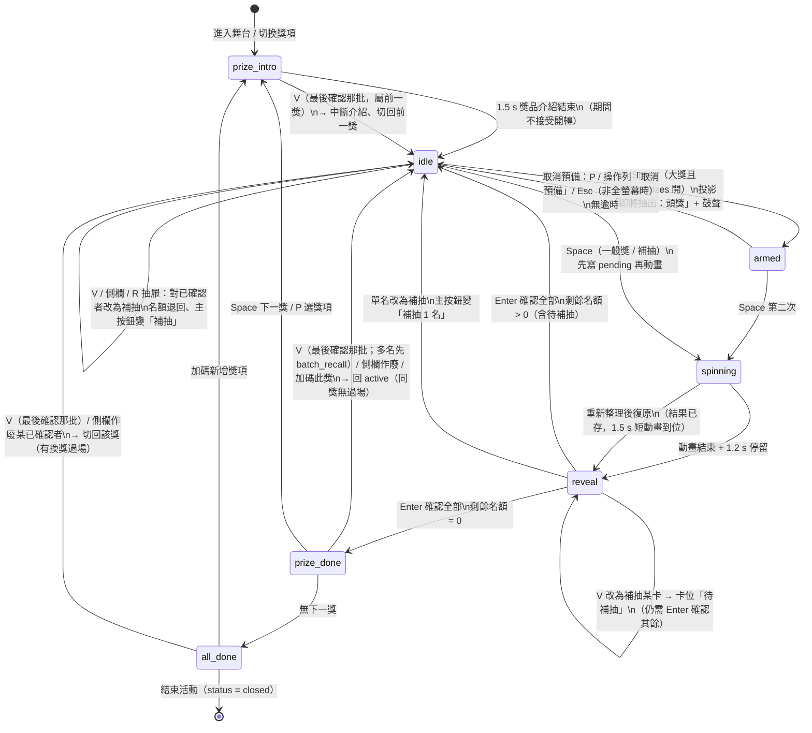
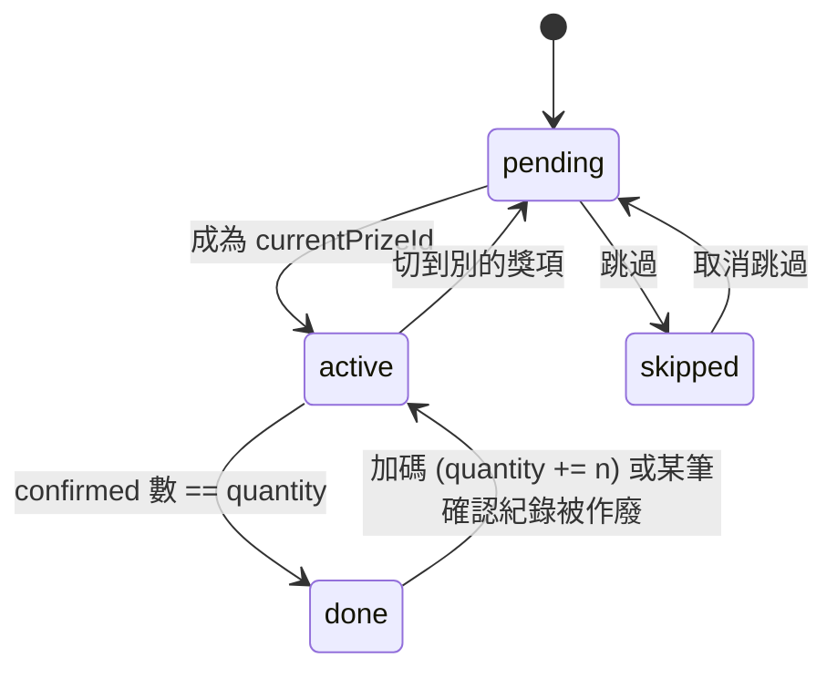
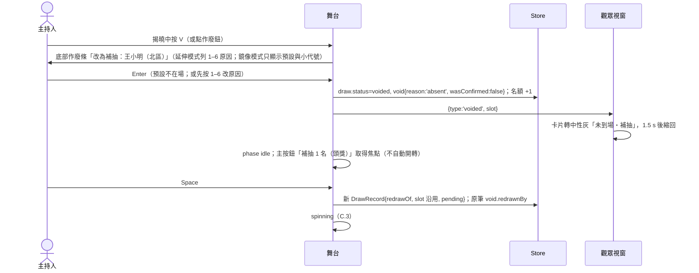
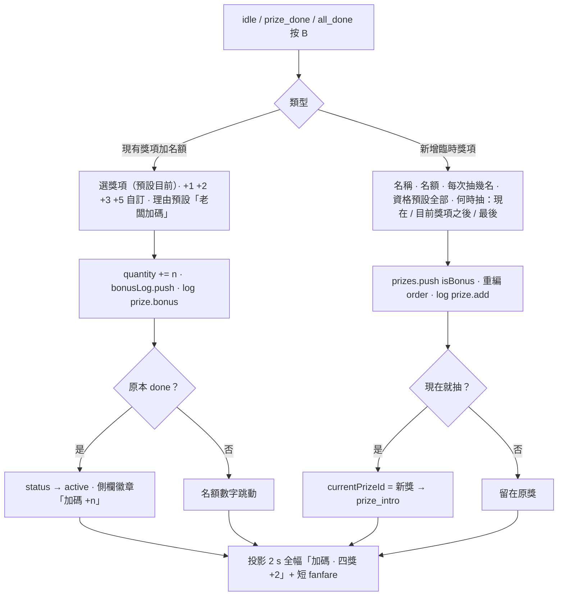

# 線上轉盤抽獎系統 — 設計規格書

> 路徑：`https://ploglin.cc/wheel/`（repo `ploglin.github.io/wheel/`）
> 版本：v1.3（2026-10-16）。v1.2 已通過 UI/UX 審查三輪；v1.3 併入審查員最後 5 條實作備註（彩排丟棄防呆與還原、promote 可選起點、多名批次 V 叫回卡片、彩排期間其他分頁不得寫入、`Shift+B`），並記錄 MVP 實作時釐清的細節（文末「v1.3 變更紀錄」）。
> 讀者：負責實作的工程師。章節 A–G 依序對應「範圍 → 資料 → 演算法 → 畫面 → 技術 → 分期 → 定案」。

**用詞約定（全文與使用者可見文案一致）**

| 使用者看到的詞 | 意義 | 程式／型別名 |
|---|---|---|
| **籤數** | 每人有幾支籤，預設 1 支；籤數 2 = 兩倍機會。**贊助功能**：編輯入口只在解鎖的分頁出現（見 A.6） | `Participant.weight`（欄位名沿用 weight，整數 ≥ 1） |
| **排除** | 本場不參加（可附原因：試用期、工作人員、主管自願…） | `Participant.excluded` + `excludeReason` |
| **作廢** | 這一筆得獎無效，紀錄保留 | `DrawRecord.status = 'voided'` |
| **補抽** | 作廢後再抽一名補上 | `DrawRecord.redrawOf` |
| **加碼** | 加名額或臨時加獎項 | `Prize.bonusLog` / `isBonus` |
| **群組** | 部門／區域／班級的統稱 | `Participant.group` |
| **彩排** | 不列入紀錄的演練 | `StageState.rehearsal` |

文案中不使用「重抽」「權重」「不參加」；按鈕不加驚嘆號；鍵位一律以 kbd 小方塊呈現（本文以 `Space`、`Enter` 等標示）。

---

## 目錄

- [0. 與站台既有慣例的對齊](#0-與站台既有慣例的對齊)
- [A. 產品範圍](#a-產品範圍)
- [B. 資料結構](#b-資料結構)
- [C. 核心演算法與程式流程](#c-核心演算法與程式流程)
- [D. UI/UX 畫面設計](#d-uiux-畫面設計)
- [E. 技術選型建議](#e-技術選型建議)
- [F. 實作分期](#f-實作分期)
- [G. 定案事項](#g-定案事項)

---

## 0. 與站台既有慣例的對齊

| 慣例 | 現況 | 本工具的做法 |
|---|---|---|
| 技術風格 | `assets/shell.css` 自述「手寫、無框架、免建置；支援淺/深色」；`school2/sim` 是純 JS 全螢幕應用 | 同樣走原生 ES modules + 手寫 CSS，不引入建置流程（E 章） |
| 設計 token | `--brand / --accent / --ink / --bg / --card / --line / --radius …`，深色由 `prefers-color-scheme` 與 `data-theme` 雙軌控制，主題記在 `localStorage.kairo_theme` | 設定模式直接引用 `../assets/shell.css` 的 token；舞台模式另有一組「舞台主題」token（深底、高對比），不改 shell.css |
| 站台外殼 | 內容頁在頁尾掛站台共用 header/footer；全螢幕應用不套主體樣式 | （v1.3 改）本工具是**獨立小程序**：不掛站台外殼、不載站台共用腳本。設定模式只有一條極簡頂列（左：轉盤小圖示＋「轉盤抽獎」回活動列表；右：主題切換兩態淺↔深、未存值跟隨系統、key `kairo_theme`），高 48 px、不黏頂；舞台頁與觀眾頁無頂列、**不放廣告** |
| 深色防閃白 | sim 在 `<head>` 第一行先讀 `kairo_theme` 套 `data-theme` | 照抄 |
| SEO | 每頁靜態手寫 title/description/canonical/OG/JSON-LD | `wheel/index.html` 保留一段無需 JS 即可讀的工具介紹（使用說明、公平性說明、FAQ）；JSON-LD 用 `WebApplication` |
| 開發文件不對外 | `_config.yml exclude` 列出 CLAUDE.md、scripts、BASELINE.md | 實作時把 `wheel/DESIGN.md`、`wheel/tests/` 加進 `exclude` |
| 導覽 | 首頁是遊戲 hub；`travel/`、`kindergarten/` 是獨立單頁 | `/wheel/` 為獨立工具，不進 `GAME_NAV`；（v1.3 改）站台首頁**不放**入口連結，靠 sitemap 收錄（G-12） |
| 分析 | GA4 `G-EL4J27F89B` | （v1.3 改）設定模式由 `app.js` 自行載入 gtag（同站台 ID，`__gtagLoaded` 防重複）；介紹段底部註明「本頁使用 Google Analytics 統計瀏覽次數，不含名單資料」並連到隱私權政策；舞台頁只送匿名計數事件（開轉次數，尚未實作），不送名單內容 |
| 圖示 | 站台部分頁用 emoji | 本工具 UI **一律 inline SVG 圖示**，不用 emoji（投影放大後 emoji 風格不一致、跨平台外觀不同） |

---

## A. 產品範圍

### A.1 一句話定位

**在瀏覽器裡就能完整跑完一場尾牙抽獎的工具**：匯入上百人名單（含行政同仁手打的「一欄一群組」Excel）、設好多個獎項、彩排一遍，投影到大螢幕，主持人只靠鍵盤就能抽完全場；作廢、補抽、老闆加碼全程留紀錄可匯出——不需要帳號、不需要後端、斷網也能用。

### A.2 使用者角色

| 角色 | 裝置 | 需求 |
|---|---|---|
| **主持人 / 操作者**（核心） | 筆電（接投影機，鏡像或延伸）或桌機；可能拿簡報筆 | 事前：建名單、設獎項、彩排。活動中：鍵盤開轉、確認、作廢、補抽、加碼。事後：匯出中獎名單 |
| **觀眾**（核心，被動） | 大螢幕 / 直播畫面 | 看得清名字與獎項、感覺公平、有氣氛；**看不到操作介面與作廢原因** |
| **第二操作者**（選配） | 另一台裝置 | 幫主持人在台下操作名單、確認得獎者是否在場 |
| **參加者自助報名**（選配） | 手機掃 QR | 現場報名進名單 |

### A.3 核心（純前端，GitHub Pages 直接可用）

1. 多場活動管理（建立時選情境預設：尾牙 / 直播 / 課堂點名；複製、刪除、匯出/匯入 JSON 備份、「帶到另一台電腦」）
2. 名單：貼上文字、CSV/Excel 匯入（**長表「一列一人」與寬表「一欄一群組」自動偵測**）、欄位對應、手動增刪改、去重、排除（附原因）、匯出
3. 籤數（贊助功能，見 A.6）：個人籤數、依群組批次設定；排除者不進候選
4. 獎項：名稱、名額、每次抽幾名、順序、圖片、參加資格限制、是否允許重複得獎
5. 抽獎舞台：**投影模式**（操作介面預設隱藏、純鍵盤操作、簡報筆模式）、轉盤（依候選人數自動選 完整 / 緊湊 / 抽樣 / 滾輪）、依人數分級的多名揭曉、大獎兩段式開轉、換獎過場
6. **彩排**：不列入紀錄的完整演練，含觀眾視窗、作廢、加碼
7. 作廢與補抽：當場或事後（舞台側欄即可）作廢、理由留痕、補抽填回原位
8. 加碼（加名額 / 臨時新增獎項），全程留紀錄
9. 中獎紀錄：含作廢原因與補抽關聯、CSV / 列印匯出
10. 公平性：`crypto.getRandomValues`、每筆抽獎附稽核資料、可選固定種子模式
11. 重新整理不掉資料（IndexedDB 寫入先於動畫）；投影用「觀眾視窗」（同一台電腦第二個視窗，`BroadcastChannel`，不需後端；按鍵可從任一視窗操作）
12. 音效、動畫、減少動態偏好、淺/深/舞台主題、無障礙

### A.4 選配擴充（需後端或第三方；獨立開發）

| 擴充 | 為什麼需要後端 | 建議方案 |
|---|---|---|
| 跨裝置同步 / 遠端觀眾頁 | 兩台裝置之間沒有共享記憶體 | Cloudflare Worker + Durable Object（WebSocket 房間，房號 6 碼）；事件資料走 D1 或 DO 記憶體 + KV 快照 |
| 參加者掃 QR 自助報名 | 手機需把資料送到主持人端 | 同上 Worker；表單 POST → D1；主持人端輪詢或 WebSocket |
| 雲端備份 / 多主持人共編 | 需要身分與儲存 | Worker + D1 + 簡易 token；不做帳號系統 |
| 公開可驗證抽獎頁 | 「公布」需要公開管道 | 核心已存稽核資料；擴充只加「一鍵發布唯讀中獎頁」 |

擴充共用同一份資料模型，核心以 `Store` 介面抽象，之後換成遠端實作不需改 UI。

### A.5 不做的事

- 不做帳號、不做付費、不做抽獎以外的投票/問卷。
- 不做排程自動抽。
- 不處理圖片編輯；獎品圖只做裁切置中。

### A.6 籤數為贊助功能

籤數的**編輯**只開放給贊助人；已設好的籤數在抽獎時**照樣生效**，不論是否解鎖。

**解鎖**
- 贊助人點 `https://ploglin.cc/wheel/#unlock=<碼>`。碼在瀏覽器以 SHA-256（hex）比對 `core/unlock.js` 的 `UNLOCK_HASH`；**碼本身不得寫進 repo 任何地方（含測試）**。可被技術破解無妨，刻意做簡單。
- `ui/unlock.js` 的 `initUnlock()` 在 `app.js` 最早同步執行（在路由的 `hashchange` 監聽與 GA `ensureGtag` 之前），並掛 `popstate`／`hashchange` 監聽（排在路由之前），處理「在已開著的分頁貼連結」。
- 流程：先**同步**用 `history.replaceState` 把網址改成 `#/`（GA 的 `page_location` 不會帶到碼），再非同步比對（`crypto.subtle`）。
  - 成功 → `sessionStorage.wheel_tickets = '1'`、`sessionStorage` 記待顯示提示、整頁重載；重載後活動列表畫完顯示 toast 8 秒「已啟用籤數：在名單頁可為每個人或整個群組設定籤數」。已解鎖再點一次顯示同一句（不重載）。
  - 失敗 → 不提示；網址已是 `#/`，路由照常畫活動列表。
- **範圍＝一次名單頁**：旗標存 `sessionStorage`。解鎖後第一次進入名單頁可編輯籤數；**離開名單頁**（換到其他分頁籤、別的活動、活動列表、舞台）即收回（`app.js` render 時以 `leavesPeople(prev, next)` 判斷、`revokeWeights()` 清旗標）。在名單頁重新整理仍有效；解鎖後先到其他頁不算用掉；關掉分頁或開新分頁也回到未解鎖。要再改籤數得再點一次連結。
- 介面文案不得出現「贊助」「解鎖」等字樣（F.1-15 文案 lint 檢查）。

**判斷（唯一一處）**：`core/unlock.js` `weightView(event, unlocked)` → `{ edit, show }`；UI 端用 `ui/unlock.js` `weightsUI(event)`。
- `edit` = `show` = 這個分頁目前持有解鎖。未解鎖時即使名單有人籤數 > 1，設定模式各頁也**不顯示**籤數（站長定案：只有解鎖那一次名單頁看得到）；籤數在抽獎時照樣生效，舞台快速名單與轉盤 ×n 依資料呈現。

**未解鎖時（edit = false）隱藏的編輯入口**：名單頁每列籤數輸入、群組「設籤數」、批次「設籤數」、新增／編輯人員對話框籤數欄（`.wh-form-row` 改兩欄，存檔保留原籤數）、依群組設籤數對話框與匯入後 toast 的捷徑、匯入對話框的「籤數」欄位對應（自動對應到籤數的欄改為「不匯入」，`mapping.js` 不讀籤數；覆蓋重複時保留原籤數 `keepWeight`）、匯入預覽的籤數欄、範本 CSV 的籤數欄（只有 姓名,群組,編號）。

**未解鎖時（show = false）**：完全不出現籤數字樣——名單頁根元素加 `.wh-noweight`，格線改用不含籤數欄的版本（手機 `"chk name more" "chk excl excl"`）、表頭不輸出籤數欄、排序 key 是 weight（含記憶的 `state.sort`）退回 name；設定頁不顯示「扇區大小」；紀錄頁說明改「每一抽都記下當時的亂數、候選人數與候選名單雜湊，可在匯出的稽核 CSV 核對。」，稽核明細不列「候選籤數總和」、「抽中第幾支籤」改稱「抽中第幾位候選人」（稽核 CSV 欄位保留）；名單 CSV 不輸出籤數欄；排除原因「匯入籤數 0」顯示為「匯入時標為不抽」。已知取捨：名單有籤數 > 1 而未解鎖時，設定模式看不出籤數仍在，但舞台扇區大小與抽獎機率仍依籤數。

---

## B. 資料結構

### B.1 設計原則

- **單一活動 = 單一文件**：一個 `Event` 包含名單、獎項、抽獎帳本、設定、舞台狀態。匯出就是序列化；匯入就是反序列化 + 遷移。
- **抽獎帳本只追加**：`DrawRecord` 永不刪除；作廢改 `status` 並附理由；補抽新增一筆並以 `redrawOf` 指回。
- **快照原則**：`DrawRecord` 存抽到當下的姓名/群組/籤數快照。
- **彩排不碰帳本**：彩排在獨立沙盒（B.4）進行，正式帳本與 `Event.status` 都不動。
- **ID**：`crypto.randomUUID()`。匯入的「員工編號」存 `code`，與內部 `id` 分開。
- **時間**：ISO 8601 字串。
- **整數籤數**：`weight` 為 1–1000 的整數；UI 不提供 0，「本場不抽」一律用「排除」表達。

### B.2 型別定義

```ts
type UUID = string;
type ISODate = string;

// ====== 活動 ======
interface Event {
  schemaVersion: 1;
  id: UUID;
  name: string;             // 1–60 字
  date?: string;            // YYYY-MM-DD，純顯示
  scenario: 'banquet' | 'stream' | 'classroom' | 'host' | 'custom';   // 建立時選的情境，只影響預設值
  createdAt: ISODate;
  updatedAt: ISODate;
  status: 'draft' | 'live' | 'closed';
  //   draft：還在設定或只彩排過；live：第一次「正式」開轉後；closed：主持人結束活動（唯讀，可重開）

  participants: Participant[];
  prizes: Prize[];          // 以 order 排序
  draws: DrawRecord[];      // 只追加；彩排的結果不在這裡
  log: EventLogEntry[];
  settings: EventSettings;
  stage: StageState;        // 正式舞台狀態（彩排狀態存在沙盒）
  counters: { drawSeq: number; batchSeq: number };
}

// ====== 參加者 ======
interface Participant {
  id: UUID;
  name: string;             // trim 後 1–40 字
  group?: string;           // 群組；寬表匯入時 = 欄標題；資格限制與批次籤數以此為鍵
  code?: string;            // 員工編號 / 學號；去重第一優先鍵
  weight: number;           // 「籤數」，整數 1–1000，預設 1。匯入遇到 0 → 設 1 並 excluded=true, excludeReason='imported-zero'
  excluded: boolean;        // 排除：本場不進候選池
  excludeReason?: 'probation' | 'staff' | 'manager' | 'imported-zero' | 'other';
  excludeNote?: string;
  tags?: string[];
  note?: string;
  extra?: Record<string, string>;   // 匯入時未對應的欄位原樣保留
  createdAt: ISODate;
  source: 'paste' | 'csv' | 'xlsx' | 'manual' | 'import' | 'stage';   // stage = 舞台上臨時新增（遲到者）
}

// ====== 獎項 ======
interface Prize {
  id: UUID;
  name: string;
  description?: string;
  imageAssetId?: UUID;
  quantity: number;         // 名額 ≥ 1；加碼會增加
  perDraw: number;          // 每次開轉抽幾名，1 ≤ perDraw ≤ quantity；決定揭曉方式（C.4）
  order: number;            // 1..n 連續
  eligibility: Eligibility;
  allowRepeatWinners: boolean | null;  // null = 沿用 settings.rules.allowRepeatWinners
  isBonus: boolean;
  bonusLog: BonusEntry[];
  status: 'pending' | 'active' | 'done' | 'skipped';   // 依 draws 推導後快取
  createdAt: ISODate;
}

type Eligibility =
  | { mode: 'all' }
  | { mode: 'include'; groups?: string[]; tags?: string[] }
  | { mode: 'exclude'; groups?: string[]; tags?: string[] };

interface BonusEntry { at: ISODate; delta: number; reason: string; byStage: boolean; }

// ====== 抽獎紀錄 ======
interface DrawRecord {
  id: UUID;
  seq: number;              // 活動內第 n 次抽出（作廢的也佔號）
  batchId: UUID;            // 同一次開轉共享
  slot: number;             // 在該批揭曉畫面的卡位 0..n-1；補抽筆沿用被補那筆的 slot（填回原位）
  prizeId: UUID;
  participantId: UUID;
  snapshot: { name: string; group?: string; code?: string; weight: number };
  status: 'pending' | 'confirmed' | 'voided';
  drawnAt: ISODate;
  confirmedAt?: ISODate;
  void?: {
    reason: VoidReason;
    note?: string;
    voidedAt: ISODate;
    wasConfirmed: boolean;  // true = 確認後才作廢（側欄或紀錄頁）
    redrawnBy?: UUID;       // 補抽那筆的 id
    editedAt?: ISODate;     // 原因/備註事後在紀錄頁修改過（log: draw.void.edit）
  };
  redrawOf?: UUID;          // 本筆是哪一筆作廢的補抽
  audit: DrawAudit;
}

type VoidReason = 'absent' | 'declined' | 'ineligible' | 'duplicate' | 'misclick' | 'other';
//   觀眾可見標籤：absent/declined → 「未到場・補抽」；其餘 → 「補抽」。原因本身永不投影。

interface DrawAudit {
  rngMode: 'csprng' | 'seeded';
  randomHex: string;        // 64-bit 亂數 16 hex
  randomUnit: number;       // 對應 [0,1)
  candidateCount: number;
  totalWeight: number;      // 候選籤數總和
  poolHash: string;         // SHA-256(候選 id:weight 以 id 排序 join) 前 16 hex
  seed?: string;
  pickIndex: number;
  wheelMode: 'full' | 'compact' | 'sampled' | 'reel' | 'none';   // none = 多名揭曉牆/格陣，無轉盤
}

// ====== 稽核日誌 ======
interface EventLogEntry {
  at: ISODate;
  type: 'prize.bonus' | 'prize.add' | 'prize.edit' | 'prize.remove' | 'prize.close'
      | 'participant.add' | 'participant.edit' | 'participant.remove' | 'participant.import'
      | 'participant.exclude' | 'participant.restore'
      | 'settings.change' | 'rules.set' | 'event.live' | 'event.close' | 'event.reopen'
      | 'draw.restore' | 'draw.void.edit' | 'bonus.revert'
      | 'rehearsal.promote';   // 彩排沙盒轉為正式紀錄（C.8）
  inStage: boolean;
  rehearsal: false;         // 彩排中的操作不寫正式 log（型別上固定 false）；promote 時只寫一筆 rehearsal.promote 總結
  summary: string;
  payload?: unknown;
}

// ====== 設定 ======
interface EventSettings {
  rules: {
    allowRepeatWinners: boolean;        // 預設 false（課堂情境 true）
    absentKeepsEligibility: boolean | null;
    //   未到場／棄權而作廢者，是否保留後續獎項資格。null = 尚未決定；建立活動時問一次，
    //   沒答則第一次作廢時再問一次（答過就不再問）。預設建議 true
  };
  // 轉盤
  wheelMode: 'auto' | 'full' | 'compact' | 'sampled' | 'reel';
  wheelThresholds: { full: number; compact: number; sampled: number };   // 預設 {48, 120, 400}（進階）
  sectorBy: 'weight' | 'equal';         // 預設 weight；自動改 equal 時轉盤下常駐說明（C.3）
  sampledSectors: number;               // 24–48，預設 36（進階）
  spinDurationMs: number;               // 3000–10000，預設 6000
  // 揭曉（C.4 依 n 分級；此處只放可調項）
  revealFlip: 'byCount' | 'manual' | 'auto';   // byCount（預設）= n ≤ 6 手動、7–12 自動（間隔 ≥ 1200 ms）；對應 D.10 三選一
  revealShowGroup: boolean;             // 預設 true
  revealShowCode: boolean;              // 預設 false
  disambiguateSameName: boolean;        // 預設 true：同名者顯示「王小明（北區）」
  autoConfirmSeconds: number | null;    // 預設 null；課堂情境 0（免確認）；倒數只在主持端顯示
  waitCountdownSec: number | null;      // 「等人上台」倒數，預設 null；設了則倒數結束才出現「未到場」捷徑
  // 舞台與操作
  projectionMode: boolean;              // 預設 true：操作介面隱藏、閒置 2 s 隱藏游標（D.5a）
  clickerMode: boolean;                 // 預設 false：PageDown = Space；PageUp 無作用
  armBigPrizes: number;                 // 最後 N 個獎項需「預備 → 開轉」兩段式；預設 2；0 = 關
  hotkeys: boolean;                     // 預設 true
  // 氣氛
  sound: { enabled: boolean; tick: number; fanfare: number; drumroll: number };
  confetti: boolean;
  motion: 'full' | 'reduced' | 'system';
  stageTheme: 'midnight' | 'festive' | 'plain';
  stageBackgroundAssetId?: UUID;
  stageTitle?: string;
  theme: 'system' | 'light' | 'dark';   // 設定模式
  // 隨機
  rngMode: 'csprng' | 'seeded';
  seed?: string;
}

// ====== 舞台狀態 ======
type Phase = 'prize_intro' | 'idle' | 'armed' | 'spinning' | 'reveal' | 'prize_done' | 'all_done';
type Overlay = null | 'void' | 'bonus' | 'prize_menu' | 'quick_list' | 'recent' | 'confirm_live' | 'rehearsal_exit' | 'help' | 'batch_recall';
//   recent = R 最近得獎抽屜；rehearsal_exit = 沙盒有 draw 時的三選一確認（取消 / 丟棄 / 轉為正式紀錄；預設焦點在［取消］）
//   batch_recall = idle / prize_done / all_done / prize_intro 對多名批次按 V 時，重新叫出那批卡片的中性浮層（v1.3）

interface StageState {
  rehearsal: boolean;               // true = 目前在彩排；對應沙盒存在
  phase: Phase;
  overlay: Overlay;                 // 浮層不是 phase；浮層開著時 phase 不變、除 Esc 外快捷鍵不作用
  currentPrizeId: UUID | null;
  currentBatchId: UUID | null;
  spin?: {
    startedAt: number;              // Date.now()
    durationMs: number;
    targetAngleDeg: number;
    easingPow: number;              // C.3 計算出的 p
    sectors: WheelSector[];
  };
  reveal?: {
    style: 'single' | 'chain' | 'wall' | 'grid';   // C.4
    flipped: number;                // 已翻牌數
    page: number;                   // grid 分頁
    pendingRedraw: number;          // 揭曉牆中已作廢、待補抽的卡位數
  };
  lastConfirmed?: { batchId: UUID; prizeId: UUID; at: number };
  //   最後確認的那一批：V 鍵與操作列「改為補抽」鈕的對象。對其他獎項開轉（spinning 寫入且 prizeId 不同）時清空；
  //   操作列鈕只在 at 後 30 s 內顯示，V 鍵不受 30 s 限制
  cardSelect?: { active: boolean; focus: number; picked: number[] };   // 揭曉中的選卡模式
  controlsVisible: boolean;         // 投影模式下操作列是否浮出（滑鼠移動 / H 鍵）
}

interface WheelSector {
  participantId: UUID | null;       // 候選 < 8 人時名字會重複排列，同一人可對應多個扇區
  label: string;
  weight: number;
  startDeg: number; endDeg: number;
  colorIndex: number;               // 群組色序；無群組時相鄰交替
  groupLabel?: string;              // compact 外圈群組色帶
}

// ====== 彩排沙盒（meta store） ======
interface RehearsalSandbox {
  eventId: UUID;
  startedAt: ISODate;
  baseUpdatedAt: ISODate;           // 進入彩排時正式 Event 的 updatedAt；promote / 還原前比對，不同即拒絕（正式 Event 在彩排期間被改過）
  baseDrawCount: number;            // 進入彩排時正式 draws 筆數；live 活動中途彩排時，之後的才算「彩排中抽出」
  event: Event;                     // 進入彩排當下的深拷貝；彩排中的一切操作都打在這份上
}
// meta.discardedRehearsal：最近一次被［丟棄］且有 draw 的沙盒（RehearsalSandbox + discardedAt），只留 1 份（v1.3）

// ====== 二進位資產 ======
interface Asset {
  id: UUID; eventId: UUID; kind: 'prize-image' | 'stage-bg';
  mime: string; blob: Blob; width: number; height: number; bytes: number; createdAt: ISODate;
}

// ====== 全域偏好（localStorage） ======
interface AppPrefs {
  prefsVersion: 1;
  lastEventId?: UUID;
  theme: 'system' | 'light' | 'dark';
  soundUnlocked: boolean;
  dismissedTips: string[];
}
```

### B.3 欄位約束與語意

| 欄位 | 約束 | 說明 |
|---|---|---|
| `weight` | 整數 1–1000 | UI 稱「籤數」；步進器最小 1，數字框停用滑鼠滾輪改值 |
| `excluded` | 布林 + 原因 | 「排除」是唯一的「本場不抽」表達；舞台側欄可即時切換，寫 log |
| `Prize.perDraw ≤ 剩餘名額` | 實際抽 `min(perDraw, remaining)` | — |
| `Prize.status` 推導 | `confirmed 數 == quantity → done`；`currentPrizeId == id → active`；手動跳過 → `skipped` | 快取進欄位 |
| `DrawRecord.seq` | 作廢的也佔號 | 「第 17 抽作廢、第 18 抽補抽」一目了然 |
| `DrawRecord.status: pending` | **同一時間最多一批 pending** | 揭曉牆中作廢某卡不會產生新 pending（卡位變「待補抽」），其餘按 `Enter` 確認後才以新批補抽（C.4） |
| `slot` | 補抽沿用原 slot | 讓補抽結果填回原卡位 |
| `Event.status → live` | 第一次**正式**開轉（非彩排）寫入 pending 時 | 彩排不改 status |
| `participants.length` | 建議 ≤ 5000 | 超過仍可用但強制 reel |
| 去重鍵 | `code` 有值 → `code`；否則 `normalize(name)+'|'+normalize(group)` | `normalize` = trim（含 U+3000、NBSP）、NFKC、合併內部空白。**同名不同群組視為兩人** |

### B.4 儲存：IndexedDB 為主，localStorage 為輔

| 考量 | localStorage | IndexedDB |
|---|---|---|
| 容量 | 約 5 MB | 數百 MB 起 |
| 二進位 | 需 base64 | 直接存 `Blob` |
| 同步/非同步 | 同步，寫大 JSON 卡 UI | 非同步，不阻塞 60 fps 動畫 |

**結構**（DB `ploglin-wheel` v1）

```
events   keyPath 'id'   索引 updatedAt
assets   keyPath 'id'   索引 eventId
meta     keyPath 'key'  — schemaVersion、lastEventId、autoBackup:<eventId>:<n>、rehearsal:<eventId>、discardedRehearsal
```

- 寫入策略：**即時寫**（開轉前、揭曉、確認、作廢、加碼、進出彩排）與**防抖 300 ms**（名單、設定編輯）。
- 彩排沙盒存 `meta.rehearsal:<eventId>`，重新整理後能接續彩排；關閉彩排或離開舞台即刪除。［丟棄］有 draw 的沙盒前先複製到 `meta.discardedRehearsal`（只留最近 1 份，可從活動列表 ⋯ 還原）。
- 首次進站 `navigator.storage.persist()`；進舞台申請 `wakeLock`。
- 自動備份：每次進入舞台（含彩排）前存一份 JSON 到 `meta.autoBackup`，保留 3 份。
- `localStorage` 只放 `AppPrefs`（`wheel_prefs`）與站台的 `kairo_theme`。

### B.5 Schema 版本與遷移

- `migrations[n]: (event) => event` 依序套用；載入與匯入共用。
- 匯入版本高於程式 → 拒絕並提示「請重新整理頁面更新」。
- 每版留 fixture 於 `wheel/tests/fixtures/`。

### B.6 匯出格式

**(1) 活動備份 JSON**

```jsonc
{
  "format": "ploglin-wheel-event", "formatVersion": 1,
  "exportedAt": "2026-01-20T10:00:00.000Z", "app": "https://ploglin.cc/wheel/",
  "event": { /* Event */ },
  "assets": [ { "id": "…", "kind": "prize-image", "mime": "image/webp", "width": 1200, "height": 800, "dataUrl": "data:…" } ]
}
```

- 檔名 `wheel-<活動名>-<YYYYMMDD-HHmm>.json`。
- **匯入時偵測同 `event.id`**：對話框「這台電腦已有『2026 公司尾牙』（最後編輯 3 天前），備份檔是 1 小時前 → [以備份取代] [另存一份]」。不同 id 直接新增。
- 「帶到另一台電腦」= 匯出 + 兩行說明（在新電腦開 ploglin.cc/wheel → 匯入備份）。

**(2) 名單 CSV（UTF-8 BOM）**：`姓名,群組,編號,籤數,排除,排除原因,標籤,備註`；另可「匯出為寬表 CSV」還原分欄外觀。

**(3) 中獎名單 CSV**：`序號,獎項,得獎者,群組,編號,狀態,抽出時間,確認時間,作廢原因,作廢備註,補抽序號`（作廢列預設不含，可勾選含）。

**(4) 稽核 CSV**：含 `audit.*`。 **(5) 列印版**：`records?print=1`。

### B.7 名單匯入：長表與寬表

| 形狀 | 長相 | 典型來源 |
|---|---|---|
| **長表（一列一人）** | 第 1 列是欄位名（姓名、群組、編號、籤數…），之後每列一人 | HR 系統、報名表單 |
| **寬表（一欄一群組）** | 第 1 列是**群組名稱**（例如 業務、行政、工務、北區、桃竹、中、南、花東），每欄往下一格一名；各欄長短不一；沒有其他欄位 | 行政同仁手打的聯絡名單（使用者的真實名單即此形：1 工作表、8 欄、74 人、最長一欄 17 人、最短 1 人，下方拖著十幾列空白） |

三種來源（貼上、CSV/TSV、xlsx）先轉成二維字串陣列 `grid`，之後偵測、清理、對應共用。

**B.7.1 來源讀取**

| 來源 | 做法 |
|---|---|
| 貼上 | 換行切列；列內以 Tab > `,` > `，` > `、` > 連續空白 的優先序偵測分隔符；單欄無表頭 → 一行一人 |
| CSV/TSV | 自寫 RFC 4180；BOM → UTF-8；否則 UTF-8 `fatal:true` 失敗再 `TextDecoder('big5')` |
| `.xlsx` | 動態載入 SheetJS（E.1）；單一工作表直接用，多個則讓使用者選；`sheet_to_json(ws,{header:1,defval:'',blankrows:false})`。**`!ref` 不可信**（實測 `A1:H34` 但資料只到第 18 列），以最後一個非空格裁切 |

**B.7.2 格子清理**

1. `NFKC`（全形英數→半形、U+3000→空白）；去頭尾空白（含 NBSP、U+200B/U+FEFF）；內部連續空白合併為一。
2. 純符號格（`-` `—` `.` `N/A` `無` `空`）視為空；完全空白的列與欄裁切後丟掉；**群組欄中間的空格直接略過**。
3. 一格多名（`王小明、李小華`、`/`）→ 預覽標黃，預設拆。
4. 不像名字的格（純數字、長度 > 20、含 `@`/`http`）→ 標紅、預設跳過。

**B.7.3 形狀自動偵測（`io/shape.js`）**

```
scoreLong: +0.5 第1列有欄位同義詞（姓名/名字/name、群組/部門/單位/區域/班級/group/dept、編號/工號/員編/學號/id/no、籤數/權重/weight、排除、標籤、備註）
           +0.2 某欄 ≥80% 是數字   +0.2 各列非空格數一致且 ≥2   +0.1 只有 1 欄
scoreWide: +0.4 第1列全部非空、皆 ≤6 字、無欄位同義詞
           +0.3 第2列以下非空格都像名字（2–4 CJK 字或 1–3 拉丁單字，無數字）
           +0.2 各欄非空長度參差（最長/最短 ≥1.5）   +0.1 欄數 ≥2 且列數 > 欄數
```

高者為預設；差距 < 0.2 才在步驟 ② 顯示「不確定，請確認格式」（確定時不顯示信心字樣）。實測名單：long 0、wide 1.0。
**單欄**一律預設長表（一行一人）；若寬表分數高出 ≥ 0.2（第 1 列像群組名）則標「不確定」讓使用者可切寬表（v1.3）。

**B.7.4 寬表 → 參加者**：每欄標題 = `group`（空標題 → 「第 n 欄」並標黃請命名；同名標題合併）；往下每個非空格一人，`weight 1`、`excluded false`。**B.7.5 長表**：表頭同義詞自動對應；無表頭 → 第 1 欄姓名、第 2 欄群組。籤數欄遇 0 → `weight 1 + excluded('imported-zero')`。

**B.7.6 去重與同名**（步驟 ③ 才出現相關選項，且只在衝突數 > 0 時）

| 層級 | 條件 | 預設 | 可改 |
|---|---|---|---|
| 1 完全相同 | 同 `code`；或同 `name`+`group` | 跳過（保留既有） | 覆蓋 / 兩筆都留 |
| 2 同名不同群組 | 同 `name`、`group` 不同 | **兩筆都留**，標「同名異組」，舞台自動顯示「王小明（北區）」 | 合併為一人 |
| 3 疑似同人 | 名字差一字（簡繁/異體）且同群組 | 只標黃 | 合併 |

匯入寫 `log: participant.import`（來源檔名、形狀、各群組人數）；完成後 toast 6 s「已匯入 74 人、8 個群組 [復原] [依群組設籤數]」（[依群組設籤數] 只在解鎖的分頁出現，A.6）。

---

## C. 核心演算法與程式流程

### C.1 候選池

每次開轉前計算一次並寫入 audit；動畫中名單變動不影響本次。

```
buildPool(event, prize, excludeIds):
  allowRepeat = prize.allowRepeatWinners ?? rules.allowRepeatWinners
  winners  = {d.participantId | d.status == 'confirmed'}
  pendings = {d.participantId | d.status == 'pending'}
  absentVoided = {d.participantId | d.status=='voided' && d.void.reason in (absent, declined)}
  for p in participants:
    if p.excluded: skip
    if !eligible(p, prize.eligibility): skip
    if !allowRepeat && p.id in winners: skip
    if p.id in pendings or excludeIds: skip
    if rules.absentKeepsEligibility == false && p.id in absentVoided: skip
    if p.id in samePrizeVoided: skip      // v1.3
    pool.push({id, weight})
  sort by id
```

彩排時 `event` 指向沙盒。

`samePrizeVoided`（v1.3）= 在**同一獎項**被作廢、且原因不是「誤觸」的人：未到場者的「保留後續資格」指的是之後的獎項，同一獎的補抽不會又抽回剛作廢的人；「誤觸」= 復原，仍可再被抽到。

### C.2 加權隨機抽選

```
pickOne(pool, rng):
  total = Σ weight; r = rng.nextUnit(); target = floor(r * total)
  前綴和線性掃或二分，回傳第一個 cumulative > target 的候選
csprng.nextUnit: Uint32Array(2) → (hi>>>5)*2^26 + (lo>>>6) 除以 2^53
seeded.nextUnit: 子種子 = SHA-256(seed + ':' + drawSeq) 前 128 bit → xoshiro128**；第三方可用匯出 JSON 復算
```

- 整池籤數和為 0 不可能（weight ≥ 1）；池為空 → 候選不足（C.7）。
- `poolHash` 以 `SubtleCrypto.digest` 計算，開轉前 `await`。

### C.3 先決定結果，再讓轉盤停在對應扇區

**流程（單名）**

```
1. pool → result = pickOne()
2. sectors = buildSectors(pool, result, settings, viewport)
3. 落點：在目標扇區內取隨機角度，與兩側分隔線的距離 ≥ max(25% 扇區寬, 外圈 6 px)；扇區太窄放不下就取正中
4. turns = 4–6 隨機整數；T = 360*turns + (360 - landDeg)
5. 緩動指數 p = clamp( ln(2.5·s / T) / ln(1 / Dsec), 1.6, 3.0 )，僅當 Dsec ≥ 2
     s = 目標扇區角度(°)，Dsec = 轉動秒數（轉盤直徑另記 Dpx，避免撞名）。保證最後 1 秒仍越過 ≥ 2.5 格邊界
     Dsec < 2（含 reduced motion 的 1.2 s）時分母趨近 0 或變號，公式不適用 → 固定 p = 3
     chain 的 Dsec = 6 × 60% = 3.6：74 格 → 3.9 → clamp 3.0；12 格 → 2.5，皆合理
     （74 格、T≈1800°、6 s → p≈2.8；12 格 → p≈1.8；easeOutQuint 在 t=80% 只剩 0.6° 幾乎不動，棄用）
6. 寫 DrawRecord(pending) + StageState{phase:'spinning', spin{...}} → await 完成
7. 開始 rAF 動畫並廣播：rotation(t) = T · (1 − (1 − t/Dsec)^p)
8. 指針越過分隔線時 tick；剩餘 ≤ 3 格時 lens（2.5× 放大鏡）浮出
9. 停止 → 指針脈動 1.2 s（寫死）→ phase 'reveal'
```

第 6 步在第 7 步前：重新整理時結果已在資料庫。開轉後不可中止，彩排才有 `S` 跳過動畫。

**buildSectors：依候選人數的四種呈現**（`auto` 以候選人數計）

| 模式 | 觸發 | 畫法 |
|---|---|---|
| **full 完整** | ≤ 48 | 每人一格，大字（≤24 格 22 px、≤36 格 18 px、≤48 格 15 px）。`sectorBy: weight` 時扇區 ∝ 籤數；`equal` 時等分並在外圈標「×2」（全員 1 籤時兩者相同，不會出現 ×n）。候選 < 8 人：**名字重複排列填滿至少 8 格**（不補空格，避免像銘謝惠顧）；只有 1 人 → 跳過轉盤直接揭曉 |
| **compact 緊湊** | 49–120 | 全部畫出、字 11–14 px、依群組排序與上色、外圈 8–10 px 群組色帶 + ≥ 20 px 群組名、lens 放大停下的格 |
| **sampled 抽樣** | 121–400，或 compact 區間手動選、或 compact 幾何不足時自動降級 | 36 格（可調 24–48）、字 20 px；得獎者必占一格，其餘以籤數不放回抽樣填入。角落顯示「候選 312 人・轉盤顯示 36 位」 |
| **reel 滾輪** | > 400，或指定 | 單一垂直滾輪減速停在得獎者；**只用於單名與 chain**，不做多滾輪並排 |

**轉盤尺寸**：`Dpx = min(主區寬, 主區高 − 資訊區 110 px − 主按鈕區) × 0.92`；投影模式主按鈕區 = 0。

| 畫面 | 投影模式 | 一般（含側欄 360 px、按鈕區 88 px） |
|---|---|---|
| 1920×1080 | 892 px | 811 px |
| 1280×720 | 561 px | 480 px |
| 1024×768 | 605 px | 524 px |

**74 人範例（使用者真實名單規模：8 群組、各 1–17 人；1080p 投影模式 D = 892，R = 446）**

| 項目 | 數值 |
|---|---|
| 每格角度 | 4.86° |
| 外圈弧長 | 37.9 px；落點與分隔線距離 ≥ 9.5 px |
| 文字處弧寬（r = 0.66 R = 294） | 25.0 px → 字 14 px（`fontPx = clamp(11, floor(arc − 9), 14)`） |
| 文字沿半徑可用長度 | 230 px；3 字名約 42 px |
| 北區籤數 ×2（總籤 87）時最小格 | 4.14° → 弧 21.2 px → 字 12 px |
| 某群組 ×3（總籤 100）時最小格 | 3.6° → 弧 18.5 px < 20 → 自動改 `equal`，轉盤下常駐「扇區等分顯示，中獎機會依籤數」（只有名單含籤數 > 1 時才可能發生） |
| 1024×768 投影（D = 605） | 文字處弧 17 px < 20 → **自動降為 sampled 36 格**，側欄說明原因 |

**可讀性照實寫**（3 m 寬幕、1920 px → 每 px 1.56 mm；舒適閱讀距離 ≈ 字高 × 200）

| 元素 | 字級 | 實體高 | 可舒適閱讀距離 |
|---|---|---|---|
| 扇區姓名 | 14 px | 2.2 cm | ≈ 4.4 m（極限 6.6 m）。**8 m 外讀不出名字，只認得群組色塊** |
| 群組色帶上的群組名 | 20 px | 3.1 cm | ≈ 6 m |
| lens 放大的姓名 | 35 px | 5.5 cm | ≈ 11 m |
| 揭曉姓名 | 120 px | 18.8 cm | 全場 |

結論：74 人全畫是為了「每個人都能在轉盤上找到自己」與群組分塊的儀式感；辨識得獎者靠 lens 與揭曉畫面，不靠扇區小字。設定頁提供「以投影尺寸預覽轉盤」（輸入投影解析度與幕寬，即時渲染並標示可讀距離）。

**色彩（寫死）**：扇區用**中高亮度色 + 深色字 `#0b1020`**（舞台底色同為 `#0b1020` 系，亮扇區在深底上最跳；白字方案實測對比只有 1.4–2.4:1，棄用）。分隔線 2 px `#0b1020`。

| 序 | 名 | Hex | 相對亮度 | 對深字 `#0b1020` 對比 |
|---|---|---|---|---|
| 1 | 黃 | `#F9DC5C` | 0.721 | 13.9:1 |
| 2 | 橙 | `#F6A821` | 0.477 | 9.5:1 |
| 3 | 紫 | `#B79CF0` | 0.401 | 8.1:1 |
| 4 | 青 | `#5ED3D1` | 0.536 | 10.6:1 |
| 5 | 藍 | `#7FB3F5` | 0.433 | 8.7:1 |
| 6 | 粉 | `#F4A0C8` | 0.485 | 9.7:1 |
| 7 | 紅 | `#F28B82` | 0.390 | 7.9:1 |
| 8 | 綠 | `#7BD389` | 0.526 | 10.4:1 |

全部 ≥ 7:1（AAA）。排列順序刻意讓相鄰色的亮度交錯（最小相鄰亮度差 0.06，藍/粉，色相本身對紅綠色盲安全），加上 2 px 深色分隔線，deuteranopia 模擬下相鄰群組仍可區分。無群組時相鄰交替取色；有群組時 `colorIndex = groupIndex % 8`，與名單頁、紀錄頁同色。

**轉盤繪製**：Canvas 2D；靜態轉盤（扇區、文字、分隔線、群組色帶）畫到離屏 canvas 一次，每幀 `rotate` + `drawImage` + 指針、中心鈕、lens；120 格以下 60 fps。文字沿半徑、字頭朝外、超長 `…`；`devicePixelRatio` 縮放。換獎時候選池改變 → 舊轉盤淡出、新轉盤扇區依序展開 600 ms。

### C.4 一次抽多名：唯一分級表

`n = min(perDraw, remaining)`。抽選一律**不放回**（每抽一名重算池並排除本批已抽者），寫入同一 `batchId`、`slot 0..n-1`、全部 `pending` 後才開始動畫。

| n | 樣式 | 呈現 | 翻牌 / 揭曉 | 轉盤 |
|---|---|---|---|---|
| 1 | `single` | 轉盤一次，停下 1.2 s，進揭曉卡（姓名 120 px） | — | 有（C.3 四模式） |
| 2–3 | `chain` | 每人各轉一次，轉動時間 60%；每次停下只亮該名 1.5 s；全部轉完進揭曉卡列（姓名 96 px） | — | 有 |
| 4–6 | `wall` | **不出現轉盤**。「名單洗牌」過場 2 s（候選名字快速閃過）→ 揭曉牆 2 列、姓名 96 px | 預設**手動**：`Space` 翻一張；可設自動（間隔 ≥ 1.2 s） | 無（audit.wheelMode 'none'） |
| 7–12 | `wall` | 同上，姓名 64 px | 預設**自動**（間隔 1.2 s）；可設手動 | 無 |
| > 12 | `grid` | 洗牌過場 → 名單格陣**一次全部揭曉**，姓名 ≥ 40 px；每頁最多 24 格，超過分頁，`Space` 翻頁 | 一次揭曉 | 無 |

- 翻牌／翻頁未完成前 `Enter` 無效；完成後焦點移到「全部確認」。
- 候選不足 n → 抽滿池內人數，缺額卡位顯示「候選不足」並在側欄提示修正捷徑。
- **揭曉中作廢某卡**：`V` 或點卡上的作廢鈕 → 底部作廢條（D.7）→ 該卡變虛線框「待補抽」（觀眾視窗顯示「未到場・補抽」或「補抽」灰卡），**不立即補抽**；可多選卡片一次作廢、原因選一次。其餘卡 `Enter` 確認 → 回 idle，主按鈕自動變「補抽 N 名」且取得焦點 → `Space` 以**一批**補滿，結果填回原 slot（補抽筆 `redrawOf` 指向各作廢筆、`slot` 沿用）。
- 單名作廢（n = 1）同理：作廢後回 idle，主按鈕「補抽 1 名（頭獎）」取得焦點，**不自動開轉**。

### C.5 狀態機

**單一獎項內的回合（`StageState.phase`；浮層另以 `overlay` 表示，不改 phase）**



- `V` 對「**最後確認的那一批**」（`StageState.lastConfirmed`）有效，phase 為 idle / prize_done / all_done / prize_intro 皆可；**唯一失效條件 = 已對其他獎項開轉**（`lastConfirmed` 在 spinning 寫入時若 prizeId 不同即清空）。操作列上的「改為補抽」捷徑鈕只在確認後 30 s 內顯示，之後靠 `V` 或 `R` 最近得獎抽屜。
- **多名批次（v1.3）**：揭曉畫面已收起，所以 `V` 先開 `overlay: batch_recall`——以中性外觀的置中浮層（鏡像模式會被投影）重新叫出那批卡片，標題只寫「第 11–13 抽・三獎」，**不得出現「作廢」字樣**；進入選卡模式（預設選中第一張仍有效的卡；方向鍵移動、`Space` 勾選、`Enter` 開作廢條、`Esc` 關閉）。單名批次直接開作廢條。

**獎項狀態**



**活動狀態**：`draft`（含只彩排過）→ `live`（第一次正式開轉）→ `closed`（可重開，寫 log）。

**彩排與正式**：`StageState.rehearsal` 與 phase 正交；切換彩排→正式必經 `overlay: confirm_live`（「開始正式抽獎？之後的結果都會記錄」），正式→彩排只在 `idle/prize_done/all_done` 且無 pending 時允許。

### C.6 作廢、補抽、加碼、復原

**作廢 → 補抽（當場，單名）**



**事後作廢（已確認者）**：四個入口開同一作廢條，`wasConfirmed: true`：(1) `V` 鍵 — 對 `lastConfirmed` 那批，phase 為 idle / prize_done / all_done / prize_intro 皆可，唯一失效條件是已對其他獎項開轉；(2) 操作列「改為補抽」鈕 — 確認後 30 s 內顯示；(3) `R` 最近得獎抽屜 — 最近 5 筆；(4) 延伸模式側欄「最近得獎」每列 `⋯`；(5) 紀錄頁。作廢後該獎名額退回、若已 `done` 則回 `active`；若目前不在該獎則**自動切回該獎**（有換獎過場；在 prize_intro 中按 V 會中斷介紹），主按鈕就地變「補抽 1 名」並取焦。多名批次先以 `batch_recall` 浮層叫回那批卡片（中性外觀、無「作廢」字樣），再進選卡模式（預設選中第一張）。設定了 `waitCountdownSec` 時，投影顯示倒數，倒數結束才顯示操作列的「改為補抽」鈕（`V`、`R` 不受影響）。

**修改作廢原因／備註（紀錄頁）**：`⋯ → 修改作廢原因 / 備註` → 同六選一 + 備註框 → 更新 `void.reason/note/editedAt`，寫 `log: draw.void.edit`（payload 含舊值新值）。鏡像模式下主持人多半用預設「不在場」，事後在此更正。

**恢復作廢**（紀錄頁）：條件 = 該獎尚有名額、此人未在他處中獎（或允許重複）、且其補抽筆尚未確認或已先作廢。寫 `log: draw.restore`。

**加碼**



- `spinning / reveal / armed` 時 `B` 無效。
- 撤回加碼（紀錄頁）：條件 `quantity − n ≥ confirmed 數`，寫 `log: bonus.revert`。

**復原（undo）政策**

| 範圍 | 做法 |
|---|---|
| 設定模式一般編輯 | Ctrl+Z / Ctrl+Shift+Z 多步（30 步，記憶體）；焦點在輸入框時交給原生 |
| 設定模式批次／破壞性操作（刪人、整組排除、批次改籤數〔解鎖時〕、匯入、刪獎項） | 完成後 **toast 6 s「已排除 業務 11 人 [復原]」**；匯入可整批復原；toast 內 `Z` 鍵 = 復原 |
| 舞台：確認得獎 | 無靜默 undo。作廢（原因「誤觸」）即是復原，走帳本 |
| 舞台：作廢 | 紀錄頁「恢復作廢」 |
| 舞台：加碼 | 「撤回加碼」 |
| 舞台：開轉 | 不可撤回、不可中止 |

### C.7 邊界情況

| # | 情境 | 處理 |
|---|---|---|
| 1 | 候選 < n | 抽滿池內人數，缺額卡位「候選不足」；側欄捷徑：允許重複得獎 / 放寬資格 / 剩餘名額歸零 |
| 2 | 候選 = 0 | 開轉禁用；側欄列出被篩掉的原因統計（已得獎 60、排除 5、資格不符 7、未到場不保留 2） |
| 3 | 抽到一半改名單/籤數（舞台「名單快速操作」） | 只影響下一次開轉；寫 `log(inStage)`；紀錄頁標「第 12 與 13 抽之間名單有異動」 |
| 4 | 轉動中重新整理 | pending 與 `spin` 已落地 → 1.5 s 短動畫到位 → reveal |
| 5 | 揭曉中重新整理 | 直接顯示揭曉畫面（卡片全展開） |
| 6 | 彩排中重新整理 | 讀 `meta.rehearsal` 沙盒續演，浮水印照常 |
| 7 | 兩分頁同開同活動舞台 | 第二個被擋：「已在另一分頁的舞台中」→ 只給觀眾模式或「接手」（原分頁變唯讀） |
| 8 | 匯入空姓名 / 非法籤數 | 預覽標紅；空姓名跳過、非法籤數設 1 |
| 9 | 同 code 不同姓名 | 三選一：保留舊 / 覆蓋 / 都留 |
| 10 | 刪除已中獎者 | 不允許，只能排除 |
| 11 | 刪除有紀錄的獎項 | 不允許；可「關閉剩餘名額」 |
| 12 | 改資格後既有得獎者不符 | 不自動作廢；紀錄頁黃標 |
| 13 | 同批同一人 | 不可能（不放回），單元測試保證 |
| 14 | 允許重複時跨批同一人同一獎 | 允許（G-5） |
| 15 | 籤數和 10^6 | `Number` 安全 |
| 16 | > 5000 人 | 強制 reel、虛擬捲動、500 列分批匯入 |
| 17 | 清除站台資料 / 私密視窗 | 首次提示 + 列表常駐白話說明 + 進舞台自動備份 |
| 18 | 1024×768 / 超寬 | 尺寸公式（C.3）；compact 幾何不足自動降 sampled；側欄寬 < 1100 收成底部抽屜 |
| 19 | 音效被擋 | 「點一下啟用音效」浮層；首次互動 `resume()` |
| 20 | reduced motion | 轉盤 1.2 s 緩動、無連續 tick、無彩帶、洗牌過場改淡入 |
| 21 | 全部抽完後再加碼 | `all_done → prize_intro` |
| 22 | seeded 中途改名單 | 允許；audit 含 poolHash |
| 23 | 螢幕休眠 | wakeLock；喚醒時 spinning 已超時直接 reveal |
| 24 | 觀眾視窗先開、主持端重載 | 觀眾端保留最後一幀、角落小點轉為灰色；主持端重載後回 `state` 全量同步 |
| 25 | 匯入 JSON 版本過新 | 拒絕並提示更新 |
| 26 | 鏡像投影下主持人需要看側欄 | 按 `H` 短暫顯示操作列；或改用延伸模式開觀眾視窗 |
| 27 | 簡報筆送出 `→`/`PageDown` | `clickerMode` 開：PageDown = Space；`→ ← PageUp` 一律忽略（不切獎項） |
| 28 | 全螢幕下按 Esc | 瀏覽器退出全螢幕；本工具不把 Esc 綁任何舞台動作（只關浮層） |
| 29 | 確認後對**其他獎**開轉 | `lastConfirmed` 清空，`V` 與操作列「改為補抽」鈕失效；仍可從 `R` 抽屜、側欄、紀錄頁作廢。對**同一獎**再開轉不清空（例如名額 3 連抽） |
| 31 | 彩排沙盒有 draw 時關閉分頁 | `beforeunload` 只能提示；沙盒保留在 `meta`，下次進該活動舞台先問「上次彩排未結束：繼續 / 丟棄 / 轉為正式紀錄」 |
| 32 | 誤把正式當彩排抽了半場 | 關閉彩排時選 [轉為正式紀錄] → promote（C.8），結果全部保留，不必再抽一次 |
| 30 | 彩排中加碼／改名單 | 只動沙盒；關閉彩排全部丟棄，關閉前提示「彩排中的加碼與名單變更不會保留」 |

### C.8 彩排

| 項目 | 規格 |
|---|---|
| 進入 | 活動列表草稿卡有**兩顆同大按鈕 [彩排] [正式開始]**（活動日期 = 今天時「正式開始」在主要位置，否則「彩排」在主要位置）；`live` 卡只有 [進入舞台]（正式），彩排由舞台工具列開關進入。**沒有「預設開啟」**：每次進舞台都是明確二選一 |
| 資料 | 開啟時深拷貝 `Event` → `meta.rehearsal:<eventId>`；舞台所有操作（開轉、作廢、補抽、加碼、名單快速操作、觀眾視窗同步）都打在沙盒上；正式 `events` 一筆不動 |
| 主持端提示 | **延伸模式**：主按鈕上方常駐黃色條「彩排中・結果不會保留」（24 px）。**鏡像模式**：操作列左段最左放「彩排中・結果不會保留」標籤，黃色外框＋黃字、不填底（避免與中段黃色主鈕成為兩顆實心黃；叫出操作列即見）；且每次揭曉後操作列自動浮出 2 s 閃一次「彩排」標記再收回。側欄獎項與最近得獎都加「彩排」小字 |
| 投影端提示 | 觀眾視窗與鏡像畫面角落常駐低調浮水印「彩排・不列入紀錄」（14 px，30% 透明；D.13 字級例外）。投影出去是刻意的，避免事後爭議 |
| 額外鍵 | `S` 跳過動畫（僅彩排） |
| 關閉 / 離開 | 沙盒**無任何 draw** → 直接刪沙盒。沙盒**有 draw** → 必經確認：「彩排中抽出了 23 筆，離開後不會保留。[取消] [丟棄] [這其實是正式抽獎，轉為正式紀錄]」。**預設焦點在［取消］**（`Enter` 不會丟棄），丟棄須明確點選或 `Tab` 到［丟棄］再 `Enter`（v1.3）。[丟棄] → 先把沙盒存到 `meta.discardedRehearsal`（只留最近 1 份）→ 刪沙盒、載回正式 Event；[轉為正式紀錄] → **promote**（下列）。退出舞台、關閉分頁前（`beforeunload` 僅能提示）、切正式 都走此確認 |
| 還原丟棄（v1.3） | 活動列表該活動卡 `⋯ → 還原最近丟棄的彩排`：只在 `meta.discardedRehearsal` 屬於此活動、正式 Event 自丟棄後未被改動（`updatedAt == baseUpdatedAt`）、且目前沒有沙盒時出現。還原 = 放回 `meta.rehearsal:<eventId>`，下次進舞台即「上次彩排未結束：繼續 / 丟棄 / 轉為正式紀錄」 |
| promote | 對話框列出沙盒中彩排期間的每一筆抽獎（第 n 筆 · 獎項 · 得獎者 · 狀態），主持人選「**從第 n 筆起才算正式**」（預設第 1 筆，v1.3）；之前的幾筆以 `misclick`（備註「彩排轉正式時未列入」）作廢後一併轉入留痕、名額退回。接著以沙盒整份 Event（draws、prizes 含加碼、participants 含舞台新增/排除、counters）**取代**正式 Event；`status → live`；寫 `log: rehearsal.promote`（payload：draws 數、加碼數、名單異動數、沙盒 startedAt、fromIndex、前段作廢筆數）；之後 `phase = prize_intro` 繼續正式抽獎。promote 前先自動備份一份正式 Event 到 `meta.autoBackup`；若正式 Event 自彩排開始後被改過（`updatedAt ≠ baseUpdatedAt`）則拒絕 promote 並說明 |
| 切正式 | `overlay: confirm_live`：沙盒無 draw 時文案「開始正式抽獎？之後的結果都會記錄」；有 draw 時即上述三選一確認 |
| `status` | 第一次正式 pending 寫入時、或 promote 時 `draft → live`，寫 `log: event.live` |
| 限制 | 帶著 pending 不能切換彩排/正式；`live` 活動開啟彩排需無 pending |
| 其他分頁（v1.3） | **彩排期間，其他分頁與觀眾視窗不得寫入正式 Event**——沿用 C.7-7 的雙分頁偵測：舞台分頁以 `BroadcastChannel` 每 2 s 廣播「持有活動 X 的舞台（彩排中）」；其他分頁的設定頁收到後轉唯讀並顯示「此活動正在另一分頁的舞台中」，store 寫入正式 Event 前檢查並拒絕。live 活動中途進彩排再 promote 時，這保證 promote 取代的正式 Event 沒有被別處改過（promote 另以 `baseUpdatedAt` 做最後防線） |
| 重新整理 | 讀 `meta.rehearsal` 續演（C.7-6） |

---

## D. UI/UX 畫面設計

### D.1 資訊架構

```
/wheel/                         靜態介紹 + app 掛載點
#/                              活動列表
#/e/:id/participants            名單          ┐ 設定模式：極簡頂列、淺/深色、左側分頁列
#/e/:id/prizes                  獎項          │
#/e/:id/settings                設定          │
#/e/:id/records                 紀錄          ┘
#/e/:id/stage                   舞台（主持人）┐ 舞台模式：無頂列、深色、全螢幕、無廣告、大字
#/e/:id/screen                  觀眾視窗      ┘
```

| | 設定模式 | 舞台模式 |
|---|---|---|
| 目的 | 事前準備、事後整理 | 進行中、投影出去 |
| 密度 | 表格表單 | 一個焦點，其餘收側欄／底部操作列 |
| 可做 | 所有編輯 | 開轉、確認、作廢、補抽、加碼、排除／恢復／新增遲到者、選獎項、查紀錄抽屜、彩排 |
| 不可做 | — | 刪人、刪獎、改規則與隨機模式、匯入 |
| 誤觸防護 | 刪除需確認、批次操作 toast 復原 | `Space` 與 `Enter` 分工；大獎兩段式；phase 轉換 600 ms 冷卻；浮層才用滑鼠 |
| 離開 | 任意 | 「退出舞台」需確認；有 pending 時先處理 |

### D.2 活動列表 `#/`

```
┌──────────────────────────────────────────────────────────────────────┐
│ [頂列：(轉盤圖示) 轉盤抽獎]                                     主題   │
├──────────────────────────────────────────────────────────────────────┤
│  我的活動                                                             │
│  資料只存在這台電腦的瀏覽器裡，換電腦或清除瀏覽紀錄就會不見，         │
│  記得匯出備份。                                                       │
│                                                                      │
│  [建立活動]  [匯入備份]                        （活動 ≥ 8 場才顯示搜尋）│
│                                                                      │
│  ┌────────────────────────────────────────────────────────────────┐ │
│  │ 2026 公司尾牙                                      進行中       │ │
│  │ 2026-01-20 · 74 人 · 6 個獎項 · 已抽 9 / 20 名額                 │ │
│  │ [進入舞台]  [編輯]  [⋯]  ⋯ = 複製 / 匯出備份 / 帶到另一台電腦 /   │ │
│  │                 結束活動 / 還原最近丟棄的彩排（有才出現）/ 刪除    │ │
│  └────────────────────────────────────────────────────────────────┘ │
│  ┌────────────────────────────────────────────────────────────────┐ │
│  │ 行銷部春酒                                         草稿         │ │
│  │ 未設日期 · 48 人 · 3 個獎項                                       │ │
│  │ [彩排]  [正式開始]  [編輯]  [⋯]   ← 兩顆同大；日期=今天時「正式開始」為主要樣式 │ │
│  └────────────────────────────────────────────────────────────────┘ │
│  ┌────────────────────────────────────────────────────────────────┐ │
│  │ 2025 尾牙                                          已結束       │ │
│  │ [查看紀錄]  [⋯ 複製名單建立新活動 / 匯出 / 刪除]                  │ │
│  └────────────────────────────────────────────────────────────────┘ │
├──────────────────────────────────────────────────────────────────────┤
│  [靜態介紹：怎麼用 / 公平性說明 / FAQ / GA 與隱私權政策小字]          │
└──────────────────────────────────────────────────────────────────────┘
```

- **建立活動**：對話框「名稱 *」「日期」「情境：尾牙 / 直播 / 課堂點名 / 抽主持人 / 自訂」（兩欄格，奇數個時最後的「自訂」整列；手機單欄）。情境只是一次帶好預設值（表）。建立後直接到名單頁。

| 情境 | allowRepeat | autoConfirm | projectionMode | armBigPrizes | revealFlip | 其他 |
|---|---|---|---|---|---|---|
| 尾牙（預設） | false | null（手動） | true | 2 | 依 n | 音效開、彩帶開 |
| 直播 | false | null | true | 1 | auto | 轉動 5 s |
| 課堂點名 | **true** | **0（免確認）** | false | 0 | auto | 音效關、彩帶關、單名 |
| 抽主持人 | false | null | true | 1 | 依 n | 轉動 8 s、音效開、彩帶開；**建立時自動建名額**（見下） |
| 自訂 | 同尾牙 | | | | | |

- **抽主持人**：選中時在情境格下方出現勾選「同時抽一位記錄人（先抽記錄人，最後抽主持人）」（預設不勾；切到其他情境隱藏、切回保留勾選）。建立成功時自動建獎項：勾 → 「記錄人」名額 1/每次 1、「主持人」名額 1/每次 1；不勾 → 只建「主持人」。主持人排最後，`armBigPrizes = 1` 的兩段式落在主持人；不重複得獎保證兩人不同。自動建名額**只在建立活動對話框**做（`core/model.js` `hostPrizes()`）；`createEvent()`、複製活動、設定頁切換情境/套用預設值都不建。
- 「未到場者是否保留後續資格」在建立對話框第二頁問一次（預設「保留」），可跳過，跳過則第一次作廢時問（C.1）。
- 草稿名單與獎項齊了 → 兩顆同大按鈕 [彩排] [正式開始]；活動日期是今天時「正式開始」套主要樣式，否則「彩排」套主要樣式。沒有「預設彩排」這件事（C.8）。
- **刪除**：確認框需輸入「刪除」兩字；框內附「先匯出備份」連結。
- **空狀態**：插圖 + 「建立第一場活動」/「匯入備份」+ 三步驟說明。
- **錯誤**：IndexedDB 不可用 → 全頁提示並允許記憶體模式。

### D.3 名單管理 `#/e/:id/participants`

以真實名單規模為例：8 群組、74 人、無編號；匯入後籤數全為 1。預設依群組顯示；左側群組清單是導覽與批次入口，主區群組標題只放名稱與動作（不重複人數）。

```
┌──────────────────────────────────────────────────────────────────────────────────┐
│ [header]  ‹ 活動列表    2026 公司尾牙                       [彩排] [正式開始]      │
├───────────┬──────────────────────────────────────────────────────────────────────┤
│ 名單   74 │  名單 · 74 人 · 8 群組                    [匯入] [新增] [⋯ 匯出 / 去重 / 全選] │
│ 獎項    6 │  ┌───────────────────────────────────────────────────────────────┐   │
│ 設定      │  │ 搜尋姓名/群組     檢視 [依群組 | 清單]   狀態 [全部 ▾]        │   │
│ 紀錄    9 │  └───────────────────────────────────────────────────────────────┘   │
│           │                                                                      │
│ 群組      │  ▾ ■ 業務                                  [設籤數] [排除全組] [⋯] │
│ ■ 業務 11 │  ┌──┬──────────────┬───────────┬───────────┬──────────┬────┐        │
│ ■ 行政 17 │  │☐ │ 王小明       │ 籤數 [ 1 ]│ ☐ 排除    │ —        │ ⋯  │        │
│ ■ 工務 11 │  │☐ │ 李小華       │ 籤數 [ 1 ]│ ☐         │ 三獎     │ ⋯  │        │
│ ■ 北區 13 │  │☐ │ 張大同       │ 籤數 [ 1 ]│ ☑ 工作人員│ —        │ ⋯  │        │
│ ■ 桃竹  6 │  │  …（單欄、列高 36 px）                                        │   │
│ ■ 中    7 │  └──┴──────────────┴───────────┴───────────┴──────────┴────┘        │
│ ■ 南    8 │                                                                      │
│ ■ 花東  1 │  ▾ ■ 行政                                  [設籤數] [排除全組] [⋯] │
│           │  │☐ │ 林志明       │ 籤數 [ 1 ]│ ☐         │ —        │ ⋯  │        │
│ 統計      │  │  …                                                                │
│ 可抽   71 │  ▸ ■ 工務     ▸ ■ 北區（籤數 ×2）   ▸ ■ 桃竹   ▸ ■ 中   ▸ ■ 南   ▸ ■ 花東 │
│ 已得獎  9 │                                                                      │
│ 排除    3 │  勾選後出現批次列：                                                   │
│ 同名異組 0│  ┌───────────────────────────────────────────────────────────────┐   │
│           │  │ 已選 13 人  [設籤數 ▾] [排除 ▾] [取消排除] [移到群組 ▾] [加標籤]  │ [刪除] │
│           │  └───────────────────────────────────────────────────────────────┘   │
└───────────┴──────────────────────────────────────────────────────────────────────┘
```

> 籤數欄與 [設籤數] 依 A.6：上圖為解鎖的分頁；未解鎖且名單有籤數 > 1 時籤數欄為唯讀「×n」、不出現 [設籤數]；未解鎖且全員 1 籤時整欄不出現（格線少一欄）。

- **籤數**欄（解鎖時）：數字框最小 1，上下鍵 ±1，**停用滾輪改值**；改完即存。
- **排除**：勾選後就地出現原因下拉（試用期 / 工作人員 / 主管自願 / 其他），已排除列灰字顯示原因。
- **群組 [設籤數]**（解鎖時）：小彈窗「業務 11 人 → 籤數 [2]  ☐ 僅套用到籤數為 1 的人」。這是「依群組批次設籤數」主路徑，2 次點擊。
- **批次列**：[刪除] 以破壞性樣式、與其他按鈕間隔 24 px。所有批次操作完成後 toast 6 s「已排除 業務 11 人 [復原]」。
- **觸控熱區**：✎、⋯、勾選框 ≥ 44×44。
- **清單檢視**：單表（姓名 / 群組 / 編號 / 籤數 / 排除 / 得獎），可排序；不顯示籤數時（A.6）沒有籤數欄。
- **去重**：四層（同 code / 同名同組 / 同名異組 / 差一字），逐群選保留。
- **匯出**：長表 CSV / 寬表 CSV。
- **空狀態**：拖放區「把 Excel / CSV 拖到這裡，或貼上名單」+ textarea；一句「Excel 兩種排法都可以：一列一人，或一欄一個群組往下列名字」。
- **行動版**：群組折疊卡、每人一列、左欄收成頂部 chip。

**匯入對話框（三步）**

步驟 ①：tab「檔案」（預設，拖放 `.xlsx/.xls/.csv/.tsv/.txt`）、「貼上」、「範本」（長表 CSV、寬表 xlsx）。選 `.xlsx` 首次顯示「正在載入 Excel 解析元件（約 400 KB）」。

步驟 ②（偵測為寬表）：

```
┌─ 匯入名單 ──────────────────────────────────────────────────────── ✕ ─┐
│  ① 來源   ② 格式   ③ 預覽                                              │
├────────────────────────────────────────────────────────────────────────┤
│  名單.xlsx · 工作表「聯絡202610」· 8 欄 × 18 列（已略過下方 16 列空白）  │
│                                                                        │
│  格式  (●) 寬表：第 1 列是群組名稱，每欄往下是名字                        │
│        ( ) 長表：一列一人（需欄位對應）                                   │
│  第 1 列 → 群組名稱 ☑                                                   │
│  ┌────────┬────────┬────────┬────────┬────────┬────────┬────────┬──────┐│
│  │■ 業務  │■ 行政  │■ 工務  │■ 北區  │■ 桃竹  │■ 中    │■ 南    │■ 花東││
│  │ 11 人  │ 17 人  │ 11 人  │ 13 人  │ 6 人   │ 7 人   │ 8 人   │ 1 人 ││
│  ├────────┼────────┼────────┼────────┼────────┼────────┼────────┼──────┤│
│  │ 王小明 │ 林志明 │ 吳建宏 │ 陳美玲 │ 周俊宏 │ 蔡佳玲 │ 許志豪 │ 楊雅婷││
│  │ 李小華 │ 黃淑芬 │ 鄭文雄 │ 劉淑惠 │ …      │ …      │ …      │      ││
│  └────────┴────────┴────────┴────────┴────────┴────────┴────────┴──────┘│
│  清理：去頭尾空白 · 略過空白格 · 拆分「、」多名 ☑ · 跳過非姓名格 ☑         │
│                                                     [‹ 上一步] [預覽 74 人 ›] │
└────────────────────────────────────────────────────────────────────────┘
```

- 不確定時才在格式列上方多一行「不確定，請確認格式」；確定時不顯示任何信心字樣。
- 偵測為長表：中間換成欄位對應表（檔案欄位 → 姓名 ★ / 群組 / 編號 / 籤數〔解鎖時〕 / 不匯入）+ 進階「籤數：以某欄換算」。切換單選即時重算。

步驟 ③：預覽（寬表維持分欄外觀；長表為表格），問題格著色，頂部「將新增 74 人（8 群組）· 跳過 0」。**只有衝突數 > 0 時**才出現「與現有名單重複：跳過 / 覆蓋 / 都留」與「同名不同群組：視為不同人 / 合併」。按「匯入」寫入並 toast 6 s「已匯入 74 人、8 個群組 [復原] [依群組設籤數]」。

### D.4 獎項管理 `#/e/:id/prizes`

```
┌───────────┬──────────────────────────────────────────────────────────────────┐
│ 名單   74 │  獎項 · 6 項 · 20 名額 · 已抽 9                 [新增獎項] [⋯ 範本 / 匯入 / 匯出] │
│ 獎項    6 │  抽獎順序（拖拉排序，由小獎到大獎；舞台可用 P 隨時切換）              │
│ 設定      │  ┌────────────────────────────────────────────────────────────┐  │
│ 紀錄    9 │  │ ⋮⋮ 1  [img] 普獎 · 禮券 500                       已抽完   │  │
│           │  │        名額 8 · 每次抽 8（格陣一次揭曉）· 資格：全部       ✎ ⋯ │  │
│           │  ├────────────────────────────────────────────────────────────┤  │
│           │  │ ⋮⋮ 2  [img] 四獎 · 耳機                           進行中   │  │
│           │  │        名額 5 (+2 加碼) · 每次抽 1 · 已抽 1 / 5            ✎ ⋯ │  │
│           │  ├────────────────────────────────────────────────────────────┤  │
│           │  │ ⋮⋮ 3  [img] 三獎 · 遊戲機                         待抽     │  │
│           │  │        名額 3 · 每次抽 3（每人各轉一次）· 資格：排除 行政   ✎ ⋯ │  │
│           │  ├────────────────────────────────────────────────────────────┤  │
│           │  │ ⋮⋮ 6  [img] 頭獎 · 手機                           待抽 · 大獎（兩段式）│
│           │  │        名額 1 · 每次抽 1 · ⚠ 候選 0 人：資格「只有 花東」且該員已得獎 │
│           │  └────────────────────────────────────────────────────────────┘  │
└───────────┴──────────────────────────────────────────────────────────────────┘
```

- 每列顯示**即時候選人數**與原因；每次抽幾名旁即時標出對應揭曉樣式（C.4）。
- 編輯抽屜：名稱 *、說明、圖片（4:3、≤ 1.5 MB）、名額 *、每次抽 [n]（旁註「4–6 名：揭曉牆手動翻牌」等）、資格（所有人 / 只有群組 / 排除群組，顯示「符合且可抽 57 人」）、重複得獎（沿用 / 允許 / 不允許）、加碼紀錄。
- 有紀錄：名額只能調大；資格可改但黃標；刪除禁用。
- 空狀態：「套用範本：普獎 / 四 / 三 / 二 / 一 / 頭獎」一鍵建 6 項。

### D.5 抽獎舞台 `#/e/:id/stage`

#### D.5a 投影模式與兩種接法

| | **鏡像（單畫面）** | **延伸（雙視窗）** |
|---|---|---|
| 接法 | 筆電畫面 = 投影畫面 | 主持人視窗留筆電，「觀眾視窗」拖到投影機 |
| 預設 | `projectionMode = true` 時進舞台即此狀態 | 開觀眾視窗後主持端自動顯示操作介面（側欄、按鈕），觀眾視窗永遠無操作介面 |
| 觀眾看到 | 與主持人同一畫面，所以**主持人介面預設全部隱藏**：無側欄、無按鈕、無快捷鍵提示；滑鼠閒置 2 s 隱藏游標 | 純舞台畫面 + 角落「候選 71 人 · 第 10 抽」小字 |
| 主持人怎麼操作 | 鍵盤（D.5b），或移動滑鼠／觸控叫出操作列後點擊：底部浮出半透明操作列（滑鼠 3 s、觸控 5 s 不動再隱藏），`H` 鍵也可叫出（鎖定顯示）。操作列中央有主動作鈕（開轉、全部確認、下一獎…），點開轉／確認／下一獎／預備／補抽後操作列立即收起、游標隱藏，800 ms 內移動滑鼠不重新浮出；揭曉下一張／下一頁不收起以便連點。觸控只叫出操作列，點畫面本身不會開轉 | 側欄 + 鍵盤；按鍵在**任一視窗**都有效（觀眾視窗把 keydown 轉送主持端） |
| 作廢 | 底部作廢條（D.7），窄、低對比、只在主持人操作期間出現；原因以數字鍵選、不顯示在卡片上 | 作廢條只在主持端；觀眾端只看到卡片轉中性灰 |
| 加碼、選獎項、名單快速操作 | 浮層置中、深色半透明；觀眾會看到「加碼」畫面（本來就要播），選獎項與名單浮層儘量簡短 | 浮層只在主持端 |
| 彩排浮水印 | 兩種接法都投影出去（刻意） | 同 |
| 建議 | 一台筆電就能跑；課堂、直播、小活動 | 尾牙大場；主持人要看側欄 |

**投影模式操作列版面**：三段式、主鈕固定正中（`grid-template-columns: 1fr auto 1fr`），三段各自一顆半透明膠囊。
- 左段（靠右對齊）：彩排標籤（外框樣式）、獎項、名單、最近得獎、加碼。
- 中段：主動作鈕（最小 200×56 px、22 px 粗體；黃底深字，「全部確認」綠底；不可用時 40% 不透明但保留位置）。文字一律對應實際動作：介紹中「獎項介紹中」、轉動中「轉動中」（彩排中改為可點的次要樣式「跳過動畫」）、全部抽完「全部抽完」；選卡模式中換成「作廢所選（N）」（N = 0 時停用）。浮層開著、選卡模式中、寫入中、phase 轉換後 600 ms 內，隱藏主按鈕與操作列主鈕皆為 `aria-disabled`，點擊不動作。點主鈕依主動作種類直接呼叫對應動作（不模擬按鍵）。
- 右段（靠左對齊）：依階段的次要鈕（揭曉中「作廢」、選卡中「取消」、確認後 30 s「改為補抽」、預備中「預備中」＋「取消預備」）、間隔 32 px、全螢幕／觀眾視窗／舞台設定／說明、間隔 48 px、最右「退出舞台」。寬度 ≤ 1500 px 時全螢幕／觀眾視窗／舞台設定／說明改為 44×44 純圖示。
- 按鈕上不放鍵位文字；`title` 統一「動作名（鍵）」並加 `aria-keyshortcuts`。焦點仍以隱藏主按鈕為目標，點操作列主鈕後焦點回到隱藏主按鈕；操作列按鈕可用 `Tab` 到達。
- 延伸模式不顯示操作列。

鏡像模式畫面（1920×1080，操作列隱藏時）：

```
┌────────────────────────────────────────────────────────────────────────────────────┐
│ 2026 公司尾牙                                                      ［彩排・不列入紀錄］│
│                                                                                    │
│                       [img]  四獎 · 耳機                                           │
│                              還有 4 名  ·  候選 71 人                              │
│                                   ▼                                                │
│                     ╭────────────────────────╮                                     │
│                  ╭──┤ 業務 ▏▏▏ 行政 ▏▏▏▏▏ 工務 ├──╮          ← 外圈 8–10 px 群組色帶 │
│                 │ ▏▏▏ ╲  ▏▏▏  │  ▏▏▏  ╱ ▏▏▏ │              + 20 px 群組名        │
│                 │ 北區 ▏▏▏ ╲ ▏▏ │ ▏▏ ╱ ▏▏▏ 桃竹 │         ← 74 格、14 px 名字、      │
│                 │ ▏▏▏▏  ─────( ◉ )─────  ▏▏▏ │            依群組排序上色          │
│                 │ 花東 ▏  ╱ ▏▏  │  ▏▏ ╲  ▏▏ 中 │                                   │
│                  ╰──┤ 南 ▏▏▏▏  │  ▏▏▏▏ ├──╯                                        │
│                     ╰────────────────────────╯                                     │
│                                                                                    │
│                                                                                    │
│                         （操作列隱藏；按 Space 開轉）                                │
└────────────────────────────────────────────────────────────────────────────────────┘
滑鼠移動 / H 時底部浮出：
│ ░░ 彩排中・結果不會保留 ● │ 獎項 P │ 名單 L │ 最近得獎 R │ 加碼 B │ 改為補抽 (30 s) │ 取消預備 │ 全螢幕 F │ 舞台設定 │      退出舞台 ░░ │
  （黃條只在彩排時出現；「改為補抽」只在確認後 30 s 內；「取消預備」只在 armed）
```

- 「舞台設定」打開音效/動畫/主題三項的小面板（不是整個設定頁）；「退出舞台」靠最右、與其他鈕間隔 48 px。
- 轉盤直徑 Dpx = 892 px（C.3 公式）。資訊區 110 px：獎品圖 96 px + 獎名 48 px + 「還有 4 名 · 候選 71 人」24 px。**觀眾看到的名額永遠是「還有 N 名」**。
- 範例數字統一：四獎原名額 3、加碼 +2 → 5、已抽 1 → 觀眾「還有 4 名」、主持人「已抽 1 / 5」；D.8 加碼浮層畫的是加碼**前**那一刻（已抽 1 / 3 → 名額 3 → 5）。

延伸模式主持端（有側欄）：

```
┌──────────────────────────────────────────────────────────────┬────────────────────────┐
│ 2026 公司尾牙             觀眾視窗已就緒，可直接在任一視窗操作 │ 獎項              P    │
│                                                              │ ✓ 1 普獎   已抽 8 / 8  │
│  ［彩排中・結果不會保留］（彩排時才有，黃條，在主按鈕上方）   │ ● 2 四獎   已抽 1 / 5  │
│          四獎 · 耳機        還有 4 名 · 候選 71 人            │                        │
│                   ▼                                          │ ○ 3 三獎   已抽 0 / 3  │
│              （轉盤 811 px）                                  │ ○ 6 頭獎   已抽 0 / 1 ★│
│                                                              │ ─────────────────────  │
│                                                              │ 最近得獎               │
│                                                              │ #9 四獎 吳大同 行政  ⋯ │
│                                                              │ #8 普獎 鄭小美 業務  ⋯ │
│                                                              │ #7 普獎 補抽 → #9      │
│        ┏━━━━━━━━━━━━━━━━━━━━━━━━━━━━━━━┓                     │ ─────────────────────  │
│        ┃         開轉   [Space]        ┃                     │ 名單快速操作      L    │
│        ┗━━━━━━━━━━━━━━━━━━━━━━━━━━━━━━━┛                     │ 加碼              B    │
│                                                              │ 紀錄抽屜               │
└──────────────────────────────────────────────────────────────┴────────────────────────┘
```

- 側欄每列 ≥ 44 px 高；「最近得獎」每列 `⋯ → 作廢`。**主持人看到的名額永遠是「已抽 x / y」**。
- 獎項列點擊 = 切換（只在 idle / prize_done），切換有 1.5 s 獎品介紹過場。
- **名單快速操作**（`L`）：搜尋框輸入姓名 → 列出符合者，可 排除 / 恢復；搜不到時出現「＋ 新增『王小明』到 [群組 ▾]」（`source: 'stage'`），都寫 log，只影響下一次開轉。
- 空狀態：沒有名單或獎項 → 不給轉盤，顯示缺什麼 + 回設定。
- 錯誤：IndexedDB 寫入失敗 → 不開始動畫，紅色橫幅「無法儲存抽獎結果，請匯出備份後重新整理」。

#### D.5b 舞台輸入模型

| 規則 | 內容 |
|---|---|
| 攔截 | 舞台快捷鍵在 `document` **capture 階段**監聽 `keydown`，命中即 `preventDefault()`+`stopPropagation()`；焦點在 `input/textarea/select` 時不攔（名單快速操作搜尋框、備註框） |
| 焦點 | 每次 phase 轉換後主動 `focus()` 到該階段主要動作（idle → 主按鈕；reveal 翻完 → 全部確認；作廢後 → 補抽鈕）；投影模式按鈕隱藏時焦點放在不可見但可聚焦的主按鈕上，aria-label 完整 |
| 防連按 | 忽略 `event.repeat`；phase 轉換後 **600 ms** 內不接受 `Space`/`Enter`（全文統一 600 ms） |
| 分工 | `Space` = 前進類（開轉 / 預備→開轉 / 補抽 / 翻牌 / 翻頁 / 下一獎）；`Enter` = 確認（只在揭曉全部翻完後）；兩者**永不互換** |
| Esc | 只關浮層、取消預備（非全螢幕時）。**不**綁跳過動畫（全螢幕時 Esc 會被瀏覽器拿去退出全螢幕） |
| 跳過動畫 | 只有彩排有 `S` |
| 切獎項 | **不用 ← →**；`P` 開獎項選單（上下鍵 + `Enter`），切換時 1.5 s 獎品介紹過場且期間不接受開轉 |
| 方向鍵 | **只在選卡模式與選單/抽屜內有效**（移動焦點）；其他時候一律忽略 |
| 選卡模式 | 揭曉中按 `V`（或操作列「作廢」）：預設選中**第一張未作廢的卡**；方向鍵移動、`Space` 勾選多張、`Enter` 開作廢條（原因選一次）、`Esc` 離開選卡。可選的卡片也能直接點擊（點一下 = 移到該卡並勾選／取消勾選）；投影操作列主位換成「作廢所選（N）」、旁邊「取消」，全程可只用滑鼠完成 |
| 大獎兩段式 | 最後 `armBigPrizes` 個獎項：第一次 `Space` → `armed`（投影「即將抽出：頭獎」+ 鼓聲），第二次 `Space` 才開轉。**無逾時**。取消方式：`P`（開獎項選單即取消）、操作列「取消預備」鈕、非全螢幕時 `Esc`；主持端（延伸側欄 / 鏡像操作列）顯示「預備中 · P 或 取消預備 可取消」 |
| 簡報筆模式 | `clickerMode = true` 時：`PageDown` 視同 `Space`；`PageUp`、`←`、`→` 忽略；`F5`、`Shift+F5`、`.`（放映 / 黑畫面鍵）攔下不作用；簡報筆的 `b` 鍵會與加碼 `B` 衝突，因此 **clickerMode 下加碼改為 `Shift+B`**（或操作列按鈕），單按 `B` 忽略。`Shift+B` 在任何模式都是加碼，主持人只需記一組（v1.3）。確認仍只能 `Enter`：簡報筆沒有 Enter，主持人以筆電鍵盤或觀眾視窗端（延伸模式）確認，或移動滑鼠、從操作列點「全部確認」；設定頁簡報筆模式旁明寫此限制。第二階段提供選項「PageUp = 確認（僅揭曉翻完後）」（F.2） |
| 浮層 | 浮層開著時只有 `Esc`、數字鍵（作廢條）、上下 `Enter`（選單/抽屜）、`N`（備註）有效；焦點 trap |
| 觀眾視窗 | `screen` 頁監聽同樣 keydown 並以 `{type:'key', key, code, shift}` 轉送主持端；主持端只接受白名單鍵；`?` 在觀眾視窗忽略 |
| 投影模式文字 | 投影模式（鏡像）畫面上**不出現任何鍵位文字**：揭曉牆未翻卡只顯示「？？？」、格陣只顯示頁碼「1 / 2」；延伸模式主持端才顯示「Space 揭曉」等提示 |

**鍵位總表**

| 鍵 | 功能 | 有效 phase |
|---|---|---|
| `Space` / `PageDown`（簡報筆模式） | 開轉 · 預備→開轉 · 補抽 · 翻下一張 · 翻頁 · 下一獎；選卡模式內 = 勾選 | idle, armed, reveal（未翻完）, prize_done |
| `Enter` | 全部確認；浮層/選單/抽屜內送出 | reveal（翻完）；任何浮層 |
| `Esc` | 關閉浮層 / 離開選卡 / 取消預備（非全螢幕） | 任何浮層；armed |
| `V` | 改為補抽：揭曉中進選卡模式；其他 phase 對「最後確認那批」（直到對其他獎開轉） | reveal, idle, prize_done, all_done, prize_intro |
| `R` | 最近得獎抽屜（5 筆，可改為補抽） | idle, prize_done, all_done |
| `P` | 獎項選單；armed 時 = 取消預備 | idle, armed, prize_done, all_done |
| `Shift+B`（任何模式）／`B`（非簡報筆模式） | 加碼；clickerMode 下單按 `B` 忽略 | idle, prize_done, all_done |
| `L` | 名單快速操作 | idle, prize_done |
| `N` | 作廢條展開備註 | overlay void |
| `1–6` | 作廢條選原因 | overlay void |
| `↑ ↓ ← →` | 只在選卡模式 / 選單 / 抽屜內移動 | 該些浮層 |
| `H` | 顯示 / 隱藏操作列（投影模式） | 任何 |
| `F` | 全螢幕 | 任何 |
| `M` | 音效開關 | 任何 |
| `S` | 跳過動畫（**僅彩排**） | spinning |
| `?` | 快捷鍵說明（主持端；鏡像模式不含作廢原因對照） | 任何 |
| `PageUp` `F5` `Shift+F5` `.`（簡報筆模式） | 攔下、無作用 | — |
| `Ctrl+Z` | 無作用 | — |

### D.6 得獎揭曉（依 C.4 分級）

**n = 1（single）**

```
┌────────────────────────────────────────────────────────────────────────────────────┐
│                               四獎 · 耳機                                           │
│                      ┏━━━━━━━━━━━━━━━━━━━━━━━━━━━━━━━━━━━┓                          │
│                      ┃          王  小  明               ┃  120 px                  │
│                      ┃          北區                     ┃  32 px（依設定）          │
│                      ┗━━━━━━━━━━━━━━━━━━━━━━━━━━━━━━━━━━━┛                          │
│                                （彩帶 2 s）                                         │
│                                                                                    │
│   鏡像模式：此處無按鈕；主持人 Enter 確認、V 作廢                                     │
│   延伸模式主持端：[確認 Enter]            [作廢 V]   （相距 ≥ 48 px、顏色對立）          │
│                              第 10 抽 · 還有 3 名                                   │
└────────────────────────────────────────────────────────────────────────────────────┘
```

**n = 2–3（chain）**：每轉一次停下只亮該名 1.5 s（lens 位置放大），全部轉完進橫排卡列，姓名 96 px，操作同上（`V` 先選卡，上下鍵移動焦點）。

**n = 4–6（wall，手動翻牌）**

```
┌────────────────────────────────────────────────────────────────────────────────────┐
│                              三獎 · 遊戲機                                          │
│            ┏━━━━━━━━━━━━━━┓   ┏━━━━━━━━━━━━━━┓   ┏━━━━━━━━━━━━━━┓                   │
│            ┃   王小明     ┃   ┃   李小華     ┃   ┃   ？？？      ┃  96 px，2 列        │
│            ┃   北區       ┃   ┃   行政       ┃   ┃              ┃                   │
│            ┗━━━━━━━━━━━━━━┛   ┗━━━━━━━━━━━━━━┛   ┗━━━━━━━━━━━━━━┛                   │
│            ┏━━━━━━━━━━━━━━┓   ┏━━━━━━━━━━━━━━┓   ┏━━━━━━━━━━━━━━┓                   │
│            ┃   ？？？      ┃   ┃   ？？？      ┃   ┃   ？？？      ┃                   │
│            ┗━━━━━━━━━━━━━━┛   ┗━━━━━━━━━━━━━━┛   ┗━━━━━━━━━━━━━━┛                   │
│                              第 11–16 抽                                            │
│   （鏡像／觀眾畫面只顯示「？？？」；「Space 揭曉」「翻完才可確認」等提示只在延伸模式主持端）  │
└────────────────────────────────────────────────────────────────────────────────────┘
作廢其中一張後（Enter 前）：
            ┏━━━━━━━━━━━━━━┓   ┌ ─ ─ ─ ─ ─ ─ ┐   ┏━━━━━━━━━━━━━━┓
            ┃   王小明     ┃   ╎  未到場・補抽 ╎   ┃   張大同     ┃      ← 虛線框、中性灰
            ┗━━━━━━━━━━━━━━┛   └ ─ ─ ─ ─ ─ ─ ┘   ┗━━━━━━━━━━━━━━┛
Enter 確認其餘 → idle，主按鈕「補抽 1 名」→ Space → 洗牌過場 → 結果填回虛線卡位
```

- 進揭曉牆前先播 2 s「名單洗牌」（候選名字快速閃過，reduced motion 改淡入）。
- 7–12 名：同版面、姓名 64 px、預設自動每 1.2 s 翻一張。

**n > 12（grid）**

```
┌────────────────────────────────────────────────────────────────────────────────────┐
│                       普獎 · 禮券 500        第 1 / 2 頁                           │
│   王小明 北區   李小華 行政   張大同 工務   陳美玲 業務   林志明 北區   黃淑芬 行政    │
│   吳建宏 中     鄭文雄 南     劉淑惠 桃竹   周俊宏 行政   蔡佳玲 業務   許志豪 工務    │
│   …（每頁最多 24 格，姓名 ≥ 40 px，一次全部揭曉）                                    │
│                                  1 / 2                                              │
│   （鏡像／觀眾畫面只顯示頁碼；「Space 下一頁 · Enter 確認」提示只在延伸模式主持端）           │
└────────────────────────────────────────────────────────────────────────────────────┘
```

- 一次揭曉（無逐張翻牌）；`V` 進入選卡模式（預設選中第一張未作廢卡；方向鍵只在此模式內移動、`Space` 勾選多張、`Enter` 開作廢條，原因選一次）。
- 確認後卡片去向：**延伸模式主持端**飛向側欄「最近得獎」；**觀眾視窗與鏡像模式**縮入畫面底部的「得獎名單」跑馬帶（最近 5 位、24 px、6 s 後淡出）。
- `autoConfirmSeconds` 開啟時倒數圈**只在主持端**（延伸模式）顯示；鏡像模式不顯示倒數，任何鍵盤動作取消倒數。

### D.7 作廢條（底部窄條，取代對話框）

兩種接法的作廢條**文字不同**，動作與鍵位相同。標題動詞統一「改為補抽」，與觀眾端卡片「未到場・補抽」語氣一致；「作廢」只出現在紀錄頁與狀態欄。

**延伸模式（只在主持端出現，觀眾視窗看不到）**

```
├────────────────────────────────────────────────────────────────────────────────────┤
│ 改為補抽：王小明（北區）  1 不在場  2 棄權  3 不符資格  4 重複得獎  5 誤觸  6 其他   N 備註 · Enter 確定 · Esc 取消 │
└────────────────────────────────────────────────────────────────────────────────────┘
```

**鏡像模式（會投影，所以不列原因清單、不高亮）**

```
├────────────────────────────────────────────────────────────────────────────────────┤
│ 改為補抽：王小明（北區）      原因預設「不在場」，可在紀錄頁修改 ·①          ［確定］［取消］ │
└────────────────────────────────────────────────────────────────────────────────────┘
```

- 高 48 px、底色 `rgba(11,16,32,.85)`、文字 20 px 灰白（D.13 字級例外）；只在主持人操作期間出現，選完即收。
- 數字鍵 `1–6` 兩種模式都有效。鏡像模式下只把條尾的小代號 `·①` 換成 `·③`（圈數字、16 px、低對比），**不顯示原因文字**；按了非 1 的鍵後「原因預設『不在場』」這段改為「原因已選」。原因對照表只在：設定頁「舞台」區、延伸模式主持端的 `?` 說明；鏡像模式 `?` 說明**不含**原因對照（主持人事前在設定頁看，或作廢後在紀錄頁修改）。
- 鏡像模式條尾是「確定」「取消」兩顆按鈕，不寫鍵位（`Enter` / `Esc` 只放在按鈕 title）；延伸模式條尾維持「N 備註 · Enter 確定 · Esc 取消」。
- `N` 展開備註輸入框（鏡像模式建議略過，事後在紀錄頁補）。
- 條上**不**提供「立刻補抽」。送出後：單名 → idle、主按鈕「補抽 1 名」取焦；揭曉牆 → 該卡「待補抽」，等 `Enter` 確認其餘。
- 對已確認者（`V`、側欄 `⋯`、`R` 最近得獎抽屜、操作列「改為補抽」鈕）開同一條，標題改「改為補抽（已確認）：王小明（北區）」。
- 「未到場者保留後續資格」規則尚未決定（`null`）時，第一次開作廢條前先出一次性浮層問一次；之後條上只在延伸模式顯示小字「未到場者保留後續資格 · 設定頁可改」。
- 作廢原因與備註可在紀錄頁事後修改（D.9），寫 `log: draw.void.edit` 並更新 `void.editedAt`。
- 觀眾端：卡片轉中性灰、文字「未到場・補抽」（absent/declined）或「補抽」（其他），1.5 s 後縮小；補抽開始時卡位顯示「補抽中」。

**最近得獎抽屜（`R`，鏡像模式補位用）**

```
┌─ 最近得獎 ───────────────────────────────┐
│ #10 四獎 王小明（北區）   已確認   改為補抽 │  ← 上下鍵選列、Enter 開作廢條
│ #9  四獎 吳大同（行政）   已確認   改為補抽 │
│ #8  普獎 鄭小美（業務）   已確認   改為補抽 │
│ #7  普獎 周俊宏（行政）   補抽 → #9          │
│ #6  普獎 林志明（北區）   已確認   改為補抽 │
└──────────────────────────────────────────┘
```

- 列最近 5 筆；延伸模式等同側欄「最近得獎」，鏡像模式是唯一能對 30 s 以前的得獎者作廢的入口（深色置中浮層、會投影、文字中性）。

### D.8 加碼浮層

```
┌─ 加碼 ─────────────────────────────────────────────── ✕ ─┐
│  [ 現有獎項加名額 ]   [ 新增臨時獎項 ]                        │
├──────────────────────────────────────────────────────────────┤
│  獎項     [四獎 · 耳機（已抽 1 / 3）        ▾]                │
│  加幾名   [+1] [+2] [+3] [+5]  自訂 [   ]                      │
│  理由     [老闆加碼                       ]                   │
│  加碼後：四獎 名額 3 → 5。候選 71 人足夠。                       │
│                                             [取消]  [加碼 Enter] │
└──────────────────────────────────────────────────────────────┘
┌─ 加碼 ─────────────────────────────────────────────── ✕ ─┐
│  [ 現有獎項加名額 ]   [ 新增臨時獎項 ]                        │
├──────────────────────────────────────────────────────────────┤
│  獎項名稱 *  [董事長加碼獎                ]                    │
│  名額 *      [ 3 ]   每次抽 [ 1 ]                              │
│  資格        [所有人 ▾]   重複得獎 [沿用 ▾]                     │
│  何時抽      (●) 現在就抽   ( ) 排在目前獎項之後   ( ) 排在最後   │
│                                             [取消]  [新增並抽 Enter] │
└──────────────────────────────────────────────────────────────┘
```

- 兩個 tab 都是最常見情境 2 次操作。成功後投影 2 s 全幅「加碼 · 四獎 +2」+ 短 fanfare（鏡像模式觀眾會看到浮層本身，浮層設計為深色置中、無多餘文字）。
- 浮層標題列右側以 kbd 小方塊提示開啟鍵：簡報筆模式顯示 `Shift+B`、否則顯示 `B`（v1.3；與鍵位總表、操作列「加碼」鈕旁的鍵位一致）。

### D.9 中獎紀錄 `#/e/:id/records`

```
┌───────────┬──────────────────────────────────────────────────────────────────┐
│ 名單   74 │  中獎紀錄 · 已確認 9 · 作廢 1 · 待確認 0      [匯出 CSV ▾] [列印]  │
│ 獎項    6 │  檢視 (●) 依獎項 ( ) 依時間   ☑ 顯示作廢                            │
│ 設定      │  ▾ 普獎 · 禮券 500   已抽 8 / 8 ✓                                   │
│ 紀錄    9 │  ┌────┬────────────┬──────┬──────┬──────────┬──────────────────┬───┐│
│           │  │ #  │ 得獎者     │ 群組 │ 編號 │ 時間     │ 狀態             │   ││
│           │  │ 1  │ 王小明     │ 北區 │ —    │ 20:12:05 │ 已確認           │ ⋯ ││
│           │  │ 7  │ ~~周俊宏~~ │ 行政 │ —    │ 20:14:10 │ 作廢 · 不在場 → 補抽 #9 │││
│           │  │ 9  │ 吳大同     │ 行政 │ —    │ 20:14:50 │ 已確認（補抽 #7）│ ⋯ ││
│           │  └────┴────────────┴──────┴──────┴──────────┴──────────────────┴───┘│
│           │  ▾ 四獎 · 耳機   已抽 1 / 5 (+2 加碼 20:31 老闆加碼 [撤回])            │
│           │  ▸ 活動日誌（14）   ▸ 稽核資訊 · csprng · [匯出稽核 CSV]               │
└───────────┴──────────────────────────────────────────────────────────────────┘
```

- `⋯`：作廢 / 恢復作廢 / **修改作廢原因・備註**（寫 `log: draw.void.edit`，列上顯示「已修改」小字）/ 查看稽核 / 跳到名單。作廢列灰字刪除線、不隱藏。
- 列印：`@media print` 依獎項分頁。

### D.10 設定 `#/e/:id/settings`

```
│  活動     名稱 [2026 公司尾牙]  日期 [2026-01-20]  情境 [尾牙 ▾]  舞台標題 [同名稱]   │
│  規則 ───────────────────────────── 🔒 有正式紀錄後鎖定                             │
│   允許重複得獎            [關]                                                      │
│   未到場者保留後續資格    [保留 ●]  作廢（不在場/棄權）的人之後仍可被抽到              │
│   隨機來源                (●) 系統安全亂數  ( ) 固定種子（可驗證） 種子 [a8f3-…][複製]  │
│  舞台 ───────────────────────────────────────────────────────────────────────── │
│   投影模式                [開]  進舞台即隱藏操作介面，滑鼠閒置 2 秒隱藏游標            │
│   簡報筆模式              [關]  PageDown 等同 Space；F5 / . 會被攔下；加碼改用 Shift+B   │
│                                 簡報筆沒有 Enter，確認請用筆電鍵盤                       │
│   作廢原因鍵位對照        1 不在場 · 2 棄權 · 3 不符資格 · 4 重複得獎 · 5 誤觸 · 6 其他   │
│                                 （鏡像投影時作廢條不顯示文字，請在此記住）                │
│   大獎兩段式              [最後 2 個獎項 ▾]  第一次 Space 預備、第二次開轉             │
│   等人上台倒數            [關 ▾ / 10 / 15 / 30 秒]                                    │
│  轉盤 ───────────────────────────────────────────────────────────────────────── │
│   模式                    [自動 ▾]   目前名單 74 人 → 緊湊完整轉盤（1080p）            │
│   扇區大小                (●) 依籤數  ( ) 等分（標 ×n）    ← 僅在 A.6 的 show 成立時   │
│   轉動時間                [6 秒] ──●──                                               │
│   [以投影尺寸預覽轉盤]  解析度 [1920×1080 ▾] 幕寬 [3 m] → 名字 2.2 cm，約 4 m 內可讀    │
│   ▸ 進階：門檻 [48][120][400] · 抽樣格數 [36]                                         │
│  揭曉 ───────────────────────────────────────────────────────────────────────── │
│   顯示群組 [開]  顯示編號 [關]  同名者加註群組 [開]                                    │
│   揭曉牆翻牌              (●) 依人數（≤6 手動、7–12 自動）  ( ) 一律手動  ( ) 一律自動   │
│   自動確認                [關 ▾]  倒數只在主持端顯示                                   │
│  氣氛 ───────────────────────────────────────────────────────────────────────── │
│   音效 [開]  轉動 ──●──  中獎 ────●  鼓聲 ───●   彩帶 [開]                            │
│   動態效果 (●) 跟隨系統 ( ) 完整 ( ) 減少   舞台主題 [午夜 ▾]  背景圖 [上傳]           │
│  資料 ───────────────────────────────────────────────────────────────────────── │
│   [匯出備份] [匯出不含圖片] [帶到另一台電腦]   自動備份 3 份 [還原…]                    │
│   [結束活動]                                   [刪除活動]                              │
```

### D.11 觀眾視窗 `#/e/:id/screen`

與鏡像模式畫面相同，另加：左下「候選 71 人 · 第 10 抽」、右下 6 px 連線小點（綠 = 同步中；灰 = 等待主持端，**不蓋畫面、保留最後一幀**）。

| 訊息（`BroadcastChannel('wheel:'+eventId)`） | 內容 | 觀眾端 |
|---|---|---|
| `state` | StageState + 當前獎 + 「還有 N 名」 | 重繪 |
| `spin` | `startedAt, durationMs, targetAngleDeg, easingPow, sectors` | 以 `Date.now()-startedAt` 對齊起轉 |
| `reveal` | 本批 snapshot（不含 audit）、style、flipped、page | 翻牌 / 翻頁 |
| `voided` | slot、公開標籤（未到場・補抽 / 補抽） | 卡轉灰 |
| `bonus` / `prize_change` / `armed` | — | 對應過場、鼓聲 |
| `key`（觀眾端 → 主持端） | 白名單鍵 | — |
| `ready`（觀眾端全螢幕後） | — | 主持端顯示「觀眾視窗已就緒，可直接在任一視窗操作」 |
| `ping/pong` | 2 s | 3 s 無回應 → 小點轉灰 |

- Chromium：有 `getScreenDetails`（Window Management API）時提供「放到第二螢幕並全螢幕」一鍵；否則提示手動拖。

### D.12 主持人動線（開場 → 抽完最後一獎；以鏡像模式、簡報筆為例）

| 步驟 | 動作 | 操作數 | 防呆 |
|---|---|---|---|
| 1 | 活動列表 → 草稿卡 [彩排] | 1 下 | 名單 0 / 獎項 0 時兩顆都禁用；日期為今天時 [正式開始] 在主要位置 |
| 2 | `F` 全螢幕（延伸模式則：操作列「觀眾視窗」→ 在新視窗 `F`；主持端出現「已就緒」） | 1 鍵（或 2 下 + 1 鍵） | — |
| 3 | 彩排：`Space` 轉一次、`Enter`、`V`→`Enter`、`Shift+B` 加碼試一次、`S` 跳動畫 | 隨意 | 操作列黃條「彩排中・結果不會保留」、每次揭曉後閃「彩排」；不寫帳本 |
| 4 | 操作列「彩排 ●」關閉 → 確認「彩排中抽出了 3 筆，離開後不會保留。」→ 點［丟棄］（或 `Tab` 到［丟棄］再 `Enter`；預設焦點在［取消］，直接 `Enter` 不會丟棄） | 1 下 + 1 下 | 有 pending 不能切；誤把正式當彩排可選 [轉為正式紀錄]（可選從第 n 筆起）；誤丟棄可從活動列表 ⋯ 還原 |
| 5 | 第一獎 1.5 s 獎品介紹後 **`Space`（簡報筆 `PageDown`）開轉** | 1 鍵 | 介紹期間與 phase 轉換 600 ms 內無效；`event.repeat` 忽略；`F5`/`.` 被攔 |
| 6 | 轉 6 s + 停留 1.2 s → 揭曉 | 0 | 不可中止、無 Esc |
| 7 | 口白、請得獎者上台 → **`Enter` 確認**（筆電鍵盤） | 1 鍵 | `Space` 在揭曉不會確認；焦點已在確認鈕 |
| 7′ | 不在場 → `V` → `Enter`（預設不在場；要改原因按 `1–6`，鏡像畫面只變小代號） → 回 idle、主按鈕「補抽 1 名」→ `Space` | 2 鍵 + 1 鍵 | 不自動開轉；原因文字不投影 |
| 7″ | 確認後才發現不在場 → `V`（任何 phase，直到對其他獎開轉；或操作列 30 s 內的「改為補抽」鈕、或 `R` 抽屜）→ 同 7′ | 同上 | 走帳本作廢，不是靜默撤回；名額 1 的獎在 prize_done/all_done 也可 |
| 8 | 4–6 名：`Space` 逐張翻 → 翻完 `Enter` | n + 1 鍵 | 翻完前 `Enter` 無效；鏡像畫面未翻卡只顯示「？？？」 |
| 8′ | > 12 名：`Space` 翻頁 → `Enter` | 頁數 + 1 鍵 | 畫面只顯示頁碼 |
| 9 | 名額抽完 → 「下一獎」`Space` → 1.5 s 介紹 | 1 鍵 | 不自動跳，給口白時間 |
| 10 | 老闆加碼 → `Shift+B`（簡報筆模式）→ `+2` → `Enter` | 1 鍵 + 1 下 + 1 鍵 | 只在 idle / done |
| 11 | 頭獎：`Space` 預備（投影「即將抽出：頭獎」+ 鼓聲）→ `Space` 開轉 | 2 鍵 | 無逾時；取消用 `P` 或操作列「取消預備」 |
| 12 | `all_done` → 操作列「退出舞台」→ 確認 | 2 下 | 有 pending 不給退 |
| 13 | 紀錄 → 匯出中獎名單 CSV；必要時 `⋯ → 修改作廢原因` | 2 下 | — |

單名每獎最少 2 鍵；大獎 3 鍵；5 名手動翻牌 7 鍵；> 12 名 2 頁 3 鍵。

### D.13 RWD 與無障礙

- 投影：1920×1080 設計；1280×720、1024×768 驗證（compact 自動降級規則）。舞台文字最小 24 px，**明確例外**：作廢條 20 px（主持人近距離操作用）、彩排浮水印 14 px（刻意低調）、鏡像作廢條小代號 16 px、觀眾視窗角落資訊 20 px、側欄 16 px（主持人用）、扇區姓名 11–14 px（C.3 已說明不靠它辨識）。對比：舞台底 `#0b1020` 上白字 ≥ 15:1；扇區深字 ≥ 7.9:1。
- 超寬：轉盤維持圓，左右放獎品圖與「得獎名單」跑馬帶。
- 手機（救急）：設定模式分頁列變頂部 tab、表格變卡片；舞台直向轉盤在上、主按鈕固定底部（`env(safe-area-inset-bottom)`、≥ 56 px）、作廢需二次確認；投影模式在手機預設關。
- 鍵盤：全部可操作；浮層 focus trap；關閉後焦點回主要動作。
- 轉盤 canvas `role="img"` + 動態 `aria-label`；揭曉 `aria-live="assertive"`。
- `prefers-reduced-motion`：C.7-20。
- 色彩不是唯一載體：狀態徽章有文字；作廢列刪除線 + 文字；群組色塊旁有群組名。
- 觸控熱區 ≥ 44×44。

---

## E. 技術選型建議

### E.1 結論：原生 ES modules + Canvas 2D，不用框架、不建置

| 選項 | 評估 |
|---|---|
| **原生 JS + 手寫 CSS** ✅ | 與站台慣例一致；push 即部署；規模（~10 畫面）可控。極簡 store（`subscribe/dispatch`）+ 字串模板 + 事件委派；大表虛擬捲動 |
| Preact/Vue CDN | 可行但收益小 |
| React/Vite | 違反站台慣例、需 build |
| **轉盤 Canvas 2D** ✅ | 離屏一次繪製、每幀 rotate；文字沿半徑、截斷、lens 都好做 |
| Excel | SheetJS CE `xlsx@0.18.5`（cdnjs，約 400 KB）`import()` 動態載入，只在選 `.xlsx/.xls` 時下載；`XLSX.read(buf,{type:'array'})` → `sheet_to_json(ws,{header:1,defval:'',blankrows:false})` → 二維陣列交 `io/shape.js`；`!ref` 尾端空列要裁 |
| CSV | 自寫 RFC 4180（約 80 行）+ Big5 偵測 |
| 音效 | Web Audio 合成（tick、fanfare、鼓聲 drumroll），零音檔 |
| 彩帶 | 自寫 canvas 粒子 |
| 雜湊 | `crypto.subtle.digest` |
| 第二螢幕 | `window.open` + `BroadcastChannel`；Chromium 加 `getScreenDetails` |
| 測試 | 純函式核心 + Node 22 `node --test`；文案 lint（i18n 檔中不得出現「重抽」「權重」「不參加」） |

### E.2 檔案 / 模組結構

```
wheel/
├── index.html                 入口：靜態介紹 + <div id="app">
├── DESIGN.md                  （_config.yml exclude）
├── wheel.css                  設定模式（引用 ../assets/shell.css token）
├── stage.css                  舞台/觀眾視窗（獨立 token、調色盤 8 色）
├── app.js                     啟動、hash 路由、全域錯誤、設定模式頂列主題切換、GA4 自載
├── core/
│   ├── rng.js                 csprng / seeded / sha256Hex
│   ├── pool.js                buildPool、eligible、poolHash、篩除原因統計
│   ├── draw.js                pickOne、drawBatch、void/restore/bonus 純函式、slot 配置
│   ├── sectors.js             buildSectors（full/compact/sampled/reel）、幾何與降級規則、落點、easingPow
│   ├── reveal-style.js        n → single/chain/wall/grid 與字級
│   ├── state.js               Phase/Overlay reducer、600 ms 冷卻
│   ├── rehearsal.js           沙盒建立/續演/丟棄/promote（含 rehearsal.promote log）
│   ├── model.js               型別 JSDoc、工廠、clamp、情境預設
│   ├── migrations.js
│   ├── dedupe.js
│   ├── stage-ops.js           （v1.3）舞台流程純函式：開轉/確認/作廢/補抽/加碼/換獎，UI 只管動畫與計時
│   └── API.md                 （v1.3，不對外）core/store/io 公開 API 清單
├── store/
│   ├── db.js  store.js  prefs.js  backup.js（含同 id 衝突偵測）  undo.js（堆疊 + toast 復原）
├── io/
│   ├── csv.js  xlsx.js  shape.js  clean.js  mapping.js  export.js
├── ui/
│   ├── dom.js（h、delegate、fitText、dialog focus trap、kbd）  router.js  toast.js
│   ├── layout-settings.js  page-home.js  page-participants.js  dialog-import.js
│   ├── page-prizes.js  drawer-prize.js  page-records.js  page-settings.js  wheel-preview.js
│   ├── stage/
│   │   ├── page-stage.js      組合；投影模式操作列、側欄切換
│   │   ├── page-screen.js     觀眾視窗、按鍵轉送、連線小點
│   │   ├── wheel-canvas.js    離屏繪製、旋轉、lens、群組色帶；reel
│   │   ├── reveal.js          single/chain/wall/grid、洗牌過場、翻牌/翻頁、選卡模式
│   │   ├── void-bar.js        底部作廢條
│   │   ├── dialog-bonus.js  prize-menu.js  quick-list.js  recent-drawer.js  prize-intro.js  rehearsal-exit.js
│   │   ├── sidebar.js  controls-bar.js  hotkeys.js（capture、白名單、簡報筆）
│   │   ├── sync.js            BroadcastChannel 協定、雙舞台偵測、Window Management
│   │   ├── audio.js  confetti.js  watermark.js
│   └── i18n.js                文案集中（zh-TW），lint 目標
└── tests/
    ├── rng  pool  draw  sectors（幾何/降級/落點/easingPow）  reveal-style  state（冷卻、Space/Enter 分工）
    ├── rehearsal  csv  shape  migrations  i18n-lint
    └── fixtures/  event-v1.json  names-300.csv  big5.csv  wide-8groups.xlsx（假名，仿真實名單形狀）
```

### E.3 與站台整合

- （v1.3 改）**獨立小程序**：`wheel/index.html` `<head>` 照站台樣板（SEO meta、防閃白讀 `kairo_theme`），只引用 `../assets/shell.css` 的 token；不載站台共用腳本、不掛站台 header/footer、不放 AdSense（G-13）。
- GA4：設定模式第一次進入時由 `app.js` 自行插入 gtag（ID `G-EL4J27F89B`，已有 gtag script 或 `__gtagLoaded` 時不重複）；`stage.html` 不載。
- `sitemap.xml` 保留 `/wheel/`、robots `index, follow`；`_config.yml exclude` 加 `wheel/DESIGN.md`、`wheel/tests`。
- 站台首頁不放入口連結（G-12 v1.3 改）。

---

## F. 實作分期

### F.1 MVP（撐完一場尾牙）

**功能**
- 活動：建立（情境預設）/ 編輯 / 刪除（輸入「刪除」）/ 列表；IndexedDB；進舞台自動備份；匯出 / 匯入 JSON（同 id 衝突對話框）；「帶到另一台電腦」
- 名單：貼上、CSV、`.xlsx`（單工作表）、長表/寬表自動偵測與切換、清理、去重預覽、增刪改、籤數、排除（原因）、依群組批次籤數、匯出；批次操作 toast 復原
- 獎項：全部欄位、資格、重複覆寫、即時候選人數、範本
- 舞台：**投影模式（鏡像）**、操作列、純鍵盤、簡報筆模式、**彩排**、四種轉盤模式與幾何降級、easingPow、lens、1.2 s 停留、換獎 1.5 s 過場、大獎兩段式、C.4 分級揭曉（single/chain/wall/grid）、作廢條（鏡像/延伸兩版）、`V` 對最後確認那批改為補抽、`R` 最近得獎抽屜、操作列 30 s「改為補抽」鈕、側欄作廢、補抽填回原位、修改作廢原因、加碼、`P` 選獎項、`L` 名單快速操作（排除/恢復/新增）、彩排 promote、全螢幕、重新整理復原
- 紀錄：依獎項/時間、作廢與補抽關聯、事後作廢、匯出 CSV、列印
- 設定：規則（含未到場保留資格）、轉盤、揭曉、氣氛、操作、資料、「以投影尺寸預覽轉盤」
- 公平性：csprng + audit
- 無障礙基本

**驗收標準**
1. 匯入 300 人 CSV（含 Big5）< 2 s；`.xlsx` 單工作表成功；離線時給「另存 CSV」指引。
2. 匯入 `wide-8groups.xlsx`（8 群組標題、各欄 1–17 假名、共 74 人、`!ref` 到第 34 列）→ 自動判寬表、74 人 8 群組、無空白人；切長表再切回預覽即時更新；步驟 ③ 無衝突時不出現衝突選項。
3. 籤數 1/2/7 三人抽 100,000 次比例 ±1%；perDraw=5 抽 10,000 批無批內重複；excluded / 資格不符 / 已得獎 / 未到場不保留 四類 0 次出現。
4. 轉動中 `reload` → 3 s 內同一得獎者，帳本僅一筆；彩排中 `reload` → 續演且 `draws` 長度不變。
5. **彩排**：草稿卡顯示 [彩排] [正式開始] 兩顆同大按鈕，日期 = 今天時 [正式開始] 為主要樣式；彩排中開轉、作廢、補抽、加碼各一次 → 關閉彩排彈出「彩排中抽出了 N 筆」三選一，**預設焦點在［取消］、直接按 `Enter` 不丟棄**；[丟棄] 後 `events` 記錄位元組相同、`status` 仍 draft，且 `meta.discardedRehearsal` 有該沙盒、活動列表 ⋯ 可還原；[轉為正式紀錄] 後正式 `draws` = 沙盒 draws、`status = live`、log 含 `rehearsal.promote` 且 `autoBackup` 多一份；選「從第 3 筆起」時前 2 筆為 `voided/misclick`；沙盒無 draw 時關閉不彈確認；彩排中另一分頁的設定頁為唯讀。延伸模式主按鈕上方有黃條；鏡像模式每次揭曉後操作列浮出 2 s。
6. **輸入模型**：按住 `Space` 1 s 只觸發一次；phase 轉換後 **600 ms** 內的 `Space/Enter` 被忽略；揭曉中 `Space` 不確認；`Esc` 在 spinning 無效；`←→PageUp` 無效；`clickerMode` 開啟時 `PageDown` 開轉、`F5`/`Shift+F5`/`.` 被攔下、單按 `B` 無作用、`Shift+B` 開加碼；方向鍵只在選卡模式移動焦點。
7. **投影模式**：進舞台後畫面上無任何按鈕、側欄、鍵位文字（揭曉牆未翻卡僅「？？？」、格陣僅頁碼）；滑鼠靜止 2 s 游標消失；移動滑鼠 300 ms 內操作列浮出；`H` 切換。操作列浮出時中央有主動作鈕、不含鍵位文字；點擊開轉後操作列立即收起，800 ms 內不重新浮出。選卡模式中主鈕為「作廢所選（N）」，點主鈕不會在「全部確認」字樣下開出作廢條；作廢條（鏡像）條尾為「確定」「取消」按鈕。
8. **轉盤幾何**：74 人 1080p 投影 → compact、字 14 px、落點與分隔線 ≥ 9 px；74 人 1024×768 → 自動 sampled 並在側欄說明；某群組 ×3 → 自動 `equal` 且轉盤下方出現說明；Dsec = 6 時最後 1 s 內指針越過 ≥ 2 條邊界（錄影逐幀）；Dsec < 2 與 reduced motion 時 p 固定 3。
9. **色彩**：8 色對 `#0b1020` 對比全部 ≥ 7:1（自動化測試算 WCAG 公式）。
10. **揭曉分級**：perDraw 1/3/5/9/30 分別進 single/chain/wall(96)/wall(64,auto)/grid(2 頁)（v1.3：原寫 20，但每頁最多 24 格時 20 名只有 1 頁，改 30）；wall 中 `V` 預設選中第一張未作廢卡 → 作廢 1 張 → 卡位虛線 → `Enter` → 主按鈕「補抽 1 名」取焦 → `Space` → 結果填回同 slot，`redrawOf` 正確。
11. **已確認者改為補抽**：名額 1 的獎確認後，在 prize_done 與 all_done 按 `V` 都能開作廢條，作廢後自動切回該獎並出現「補抽 1 名」；名額 3 的批次確認後按 `V` 先出現 batch_recall 卡片浮層（無「作廢」字樣）再選卡；對其他獎開轉後 `V` 不再作用；`R` 抽屜仍可對最近 5 筆作廢；操作列「改為補抽」鈕 30 s 後收起。側欄作廢 → 名額 +1、done 回 active。
12. **大獎兩段式**：倒數第 2 個獎項第一次 `Space` 進 armed（鼓聲、投影文字），第二次開轉；等 60 s 不自動取消；`P` 與操作列「取消預備」可取消；主持端顯示取消方式。
13. **作廢條**：鏡像模式條上不出現 1–6 原因文字、按 `3` 只變小代號；延伸模式列出原因；`?` 在鏡像模式不含原因對照。紀錄頁 `⋯ → 修改作廢原因` 後 `void.reason` 更新、log 含 `draw.void.edit`。
14. 名額文案：觀眾視窗與鏡像畫面出現「還有 N 名」且不出現「已抽」；側欄出現「已抽 x / y」。
15. **文案 lint**：i18n 檔 grep「重抽」「權重」「不參加」「！」= 0；emoji = 0；「剛才那位不在場」= 0；加碼鍵位提示（`?` 鍵位說明、操作列、加碼浮層）含 `Shift+B`，不出現與鍵位總表矛盾的寫法（v1.3）。
16. 全程只用鍵盤抽完 3 個獎項（含一次作廢補抽、一次加碼）。
17. Lighthouse Accessibility ≥ 95（設定模式）；舞台頁對比全過 AA。
18. 無 console error；IndexedDB 不可用時降級並提示。

### F.2 第二階段

**功能**
- **觀眾視窗**（延伸模式）：BroadcastChannel 同步、**按鍵轉送**、「已就緒」提示、連線小點、Window Management API 一鍵放到第二螢幕；雙舞台偵測與接手
- 獎品圖片、舞台背景、`festive` 主題
- Excel 進階：多工作表、年資→籤數換算
- seeded 可驗證模式 + 稽核 CSV + 獨立 `verify.html`
- 恢復作廢、撤回加碼、活動日誌檢視、候選 0 人診斷面板
- 「等人上台」倒數、自動確認倒數（主持端）
- 簡報筆模式選項「PageUp = 確認（僅在揭曉全部翻完後有效）」，預設關
- 獎項 CSV 匯入/匯出、複製活動、首次使用導覽
- 手機版舞台
- i18n key 化

**驗收**
1. 觀眾視窗與主持端轉盤停止時間差 < 50 ms；在觀眾視窗按 `Space/Enter/V/1` 與主持端等效；`?` 在觀眾視窗無反應。
2. 觀眾視窗斷線（關主持端分頁）→ 保留最後一幀、小點轉灰、不出現遮罩；主持端重載後 3 s 內恢復同步。
3. seeded：以匯出 JSON 復算 100% 吻合；`verify.html` 拖入即驗。
4. 5 張 3 MB 圖 → 自動 ≤ 1.5 MB、備份可在另一台瀏覽器完整還原。
5. 手機 Safari 完成 2 獎項抽獎；底部主按鈕不被工具列遮住。
6. 雙分頁同開舞台 → 第二個被擋並提供觀眾模式。

### F.3 選配擴充（需後端）

| 項目 | 範圍 | 驗收 |
|---|---|---|
| 遠端觀眾頁 | Worker + Durable Object WebSocket；`sync.js` 加 `RemoteTransport`，協定同 BroadcastChannel（含按鍵轉送） | 跨裝置停止差 < 300 ms；斷線 10 s 內重連全量同步 |
| QR 自助報名 | Worker + D1；主持端輪詢/推播新增 participant（`source: 'import'`） | 100 人 1 分鐘內全進；以 code 去重 |
| 雲端備份 | Worker + D1 + 一次性 token | 與 JSON 格式一致 |
| 公開驗證頁 | 一鍵發布唯讀中獎頁 | 可勾選是否含 audit |

---

## G. 定案事項

以下為使用者已同意的決定（全部採用設計預設，並套用審查調整）。「鎖定」= 有正式紀錄後不可改。

| # | 事項 | 定案 | 理由 |
|---|---|---|---|
| G-1 | 已得獎者可否再得獎 | **不允許**（活動層級），每個獎項可單獨覆寫為允許；課堂情境預設允許 | 尾牙「小獎不影響大獎」用獎項覆寫即可；全域不允許最安全。鎖定 |
| G-2 | 扇區大小是否依籤數 | **依籤數**；幾何不足（文字處弧寬 < 20 px）自動改等分並在轉盤下常駐「扇區等分顯示，中獎機會依籤數」 | 觀眾看得見「資深多一支籤」；自動降級避免名字擠爆 |
| G-3 | 大名單轉盤門檻 | ≤ 48 完整大字；49–120 **緊湊全畫**（依群組排序上色、lens 放大）；121–400 抽樣 36 格；> 400 滾輪。74 人落在緊湊。**照實說明**：14 px 名字約 4 m 內可讀，8 m 外只認得群組色塊；設定頁提供「以投影尺寸預覽轉盤」 | 中小型場合「每個人都在轉盤上」比字大重要；辨識靠 lens 與揭曉 |
| G-4 | 未到場／棄權而作廢者的後續資格 | **活動層級規則「未到場者保留後續資格」，預設保留**；建立活動時問一次，沒答則第一次作廢時問；作廢條只顯示目前規則 | 作廢條上不該每次做政策決定；規則一致可稽核。鎖定 |
| G-5 | 允許重複得獎時同一獎項可否重複中 | 可以 | 不加第二層規則 |
| G-6 | 籤數形式 | 資料型別整數 1–1000；**對外一律稱「籤數」**；0 不在 UI 出現，「不抽」用排除表達 | 「權重」對非技術使用者不直覺；排除有原因可查 |
| G-7 | 舞台 undo | **不提供靜默 undo**；誤觸以作廢（原因「誤觸」）留痕；前提是對已確認者的作廢路徑足夠短：`V`（最後確認那批，直到對其他獎開轉）、`R` 抽屜、操作列 30 s 鈕、側欄（已納入） | 稽核可信度優先；作廢路徑夠短就不需要撤回 |
| G-8 | 隨機模式預設 | csprng；可切固定種子（鎖定） | 一般尾牙不需保管種子 |
| G-9 | 揭曉牆翻牌 | **n ≤ 6 預設手動**（`Space` 逐張，配合口白）；7–12 自動、間隔 ≥ 1.2 s；> 12 格陣一次揭曉；可在設定改為一律手動/自動 | 少量時口白節奏重要；多量時逐張太慢 |
| G-10 | 自動確認 | 預設關閉；開啟時倒數只在主持端顯示；課堂情境直接免確認 | 投影上出現倒數會給觀眾壓力 |
| G-11 | 觀眾視窗的分期 | 第二階段；**MVP 必有投影模式（鏡像）**；觀眾視窗做時按鍵轉送一起做 | 一台筆電鏡像就能跑完整場 |
| G-12 | 站台首頁入口 | （v1.3 改）不放入口；`/wheel/` 為獨立小程序，靠 sitemap 收錄 | 攻略站定位、AdSense 複查中 |
| G-13 | AdSense | 舞台頁不放；設定頁先不放 | 投影出現廣告不體面 |
| G-14 | Excel 匯入依賴 | 接受 SheetJS CDN 動態載入；離線提示另存 CSV | 使用者的真實名單就是 xlsx |
| G-15 | 名單上限 | 5000（超過強制滾輪並提示） | — |
| G-16 | 命名與網址 | `/wheel/`、「轉盤抽獎」、title「線上轉盤抽獎｜尾牙春酒抽獎工具」 | — |
| G-17 | 資料保留提示 | 首次提示 + 列表常駐白話說明 + 進舞台自動備份 3 份；不強迫下載 | — |
| G-18 | 同名不同群組 | 視為兩人；活動內同名全程顯示「王小明（北區）」 | 真實名單 74 人無同名，但下一年可能有 |
| G-19 | 「群組」用詞 | 保留「群組」 | 涵蓋部門／區域／班級 |
| G-20 | 寬表欄標題自動配色 | 是；依欄序配 8 色，轉盤、名單、紀錄同色；色值與對比見 C.3 | 群組分塊是 74 人轉盤的主要可讀訊息 |

---

### v1.3 變更紀錄

| # | 變更 | 段落 |
|---|---|---|
| 1 | 「丟棄彩排」不可預設丟棄：預設焦點在［取消］；丟棄前存 `meta.discardedRehearsal`（最近 1 份）；活動列表 ⋯「還原最近丟棄的彩排」 | B.2、B.4、C.8、D.2、D.12-4、F.1-5 |
| 2 | promote 可選起點：從第 n 筆起才算正式，之前以 `misclick` 作廢後轉入留痕；`baseUpdatedAt` 防線 | B.2、C.8、F.1-5 |
| 3 | idle / prize_done 對多名批次按 `V`：`batch_recall` 中性浮層叫回卡片（不寫「作廢」）再選卡 | B.2 Overlay、C.5、C.6、F.1-11 |
| 4 | 彩排期間其他分頁 / 觀眾視窗不得寫入正式 Event（沿用 C.7-7 雙分頁偵測） | C.8 |
| 5 | `Shift+B` 在任何模式都是加碼；鍵位總表、加碼浮層提示、F.1-15 同步 | D.5b、D.8、F.1-15 |
| 6 | 實作釐清：`revealFlip` 增 `byCount`；同一獎項作廢者（誤觸除外）不再被該獎補抽抽到；單欄名單預設長表；F.1-10 的 grid 範例改 30 名；無任何抽獎的獎項「關閉剩餘名額」改為跳過 | B.2、C.1、B.7.3、F.1-10、C.7-1 |
| 7 | 新情境「抽主持人」（`host`）：預設值見 D.2 表；建立對話框可勾「同時抽一位記錄人」，建立成功時自動建「記錄人」「主持人」名額（主持人最後、兩段式）；只在建立路徑做，複製活動與設定頁切換情境不建。**已知問題（未改）**：舞台與紀錄頁沿用「得獎／中獎」用語，抽主持人時語感不貼切 | B.2、D.2 |
| 8 | 移除站台導覽列：改為獨立小程序，設定模式只留極簡頂列（品牌回列表＋主題兩態切換，48 px、不黏頂、safe-area），`--hdr-h` 設 0；GA4 由 `app.js` 自載；首頁標題改「我的活動」；介紹段底部加 GA 說明與隱私權政策連結；站台首頁撤掉入口連結（sitemap 保留） | 0 章、D.1、D.2、E.2、E.3、G-12 |
| 9 | 籤數改為贊助功能：`#unlock=<碼>` 解鎖（SHA-256 比對、sessionStorage、只到關分頁）；未解鎖隱藏編輯入口，已設好的籤數照樣生效、唯讀顯示依資料；首頁介紹不再提籤數 | A.6、B.7、D.3、D.9、D.10 |

---

### 附錄：術語對照

| 中文（使用者可見） | 程式名 | 說明 |
|---|---|---|
| 活動 | Event | 一場尾牙 |
| 參加者 / 名單 | Participant | — |
| 群組 | group | 部門／區域／班級統稱；寬表欄標題 |
| 長表 / 寬表 | long / wide | 一列一人 / 一欄一群組 |
| 籤數 | weight | 整數 ≥ 1 |
| 排除 | excluded + excludeReason | 本場不抽 |
| 獎項 / 名額 / 每次抽幾名 | Prize / quantity / perDraw | — |
| 一批 / 卡位 | batch / slot | 同一次開轉；揭曉畫面位置 |
| 第 n 抽 | DrawRecord.seq | 帳本一筆 |
| 確認 / 作廢 / 補抽 | confirmed / voided / redrawOf | — |
| 加碼 | bonus | — |
| 候選池 | pool | — |
| 完整 / 緊湊 / 抽樣 / 滾輪 | full / compact / sampled / reel | 轉盤呈現 |
| 單抽 / 連轉 / 揭曉牆 / 格陣 | single / chain / wall / grid | 依 n 的揭曉樣式 |
| 預備 | armed | 大獎兩段式第一段 |
| 彩排 | rehearsal | 不列入紀錄 |
| 投影模式 / 鏡像 / 延伸 | projectionMode / mirror / extended | 操作介面隱藏；單畫面 / 雙視窗 |
| 舞台 / 觀眾視窗 | stage / screen | 主持人端 / 投影端 |
